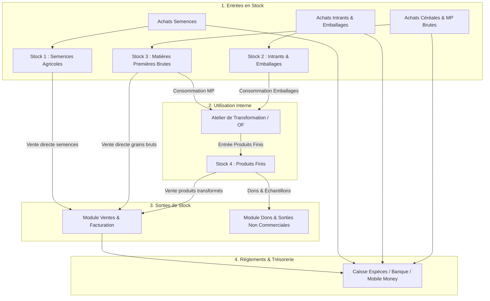
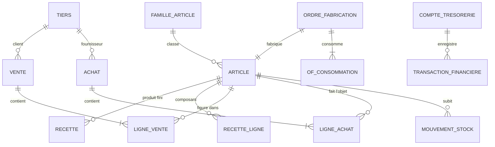

# ERP KEITALA — Dossier d'Analyse, de Spécification des Besoins & de Conception

---

## 1. Contexte & Diagnostic de l'Existant

### 1.1 Présentation de l'Entreprise
**KEITALA** est une entreprise agroalimentaire et commerciale spécialisée dans :
1. **Le stockage, l'approvisionnement et la commercialisation de produits agricoles bruts, semences et intrants** (semences sélectionnées de soja/maïs, grains de consommation, emballages et intrants).
2. **La transformation agroalimentaire locale, le conditionnement et la vente** (café de soja, soumbala, attiéké, gari, tapioka, djouka, fonio, farines et huiles).

Zone économique : Afrique de l'Ouest (zone UEMOA / devise : **Franc CFA - FCFA**).

### 1.2 Analyse du Fichier Source (`ERP_Keitala.xlsx`)
L'analyse des 17 feuilles Excel met en évidence les points suivants au niveau des stocks :

* **Feuille `Matieres_Premieres`** :
  * Présence de semences agricoles : `Soja Semence` géré en deux unités (`MP-SOJ-SEM-KG` et `MP-SOJ-SEM-SAC` de 50 kg) avec un prix de vente (1 000 FCFA/kg).
  * Présence de céréales de consommation : `Soja Consommation`, `Maïs`, `Mil`, `Pâte de Manioc` (gérés à la fois en kg et en sacs de 50 kg).
* **Feuilles `Achats` et `Ventes`** :
  * Les matières premières agricoles et semences font l'objet d'achats en gros (ex. 7 000 kg de graine de soja à 290 FCFA) et de ventes directes (ex. 10 000 kg à 320 FCFA) sans passer par la transformation.
  * Les produits finis sont vendus en sachets/bouteilles (ex. Café de soja, Gari).
* **Feuille `Depenses`** :
  * Achat d'intrants et consommables (packs d'emballages pour attiéké, produits d'entretien, sacs).
* **Anomalies constatées dans l'Excel** :
  * Formules de stocks cassées (`#NAME?` dues à `SOMME.SI`), stocks négatifs (Café de soja à `-9`), absence de conversion automatique entre sacs de 50 kg et kilogrammes, et absence de suivi unifié des intrants/emballages.

---

## 2. Architecture Globale des Flux Métier

---

## 3. Spécifications Détaillées des Modules

### Module 1 : Gestion des Stocks Multi-Familles (Cœur du Système)

Le système segmente les stocks en **5 familles d'articles étanches et configurables** :

| Famille d'Article | Description & Exemples | Unités gérées | Types de mouvements autorisés |
| :--- | :--- | :--- | :--- |
| **1. Semences Agricoles** | Semences sélectionnées et certifiées (Soja semence, Maïs semence, etc.) destinées à la vente ou à la réserve. | Kilogramme (kg), Sac de 50 kg. | Entrée achat, Sortie vente directe, Sortie cession, Ajustement inventaire. |
| **2. Intrants Agricoles & Traitement** | Produits de traitement des grains/semences, fertilisants, produits de conservation, sacs vides. | Sac, Litre, Flacon, Unité. | Entrée achat, Sortie utilisation, Sortie vente éventuelle, Ajustement. |
| **3. Matières Premières & Récoltes** | Grains et tubercules bruts (Soja consommation, Maïs, Mil, Fonio brut, Pâte de manioc, Arachide). | Kilogramme (kg), Sac de 50 kg, Tonne. | Entrée achat bord-champ/marché, Sortie pour transformation (OF), Sortie vente directe en vrac. |
| **4. Emballages & Conditionnement** | Sachets imprimés (200g, 400g, 500g, 900g, 1kg), packs, bouteilles huile (500ml, 1L), étiquettes, cartons. | Unité, Paquet / Pack, Rouleau. | Entrée achat, Sortie consommation conditionnement, Rebuts/casse. |
| **5. Produits Finis Transformés** | Produits prêts à la vente (Café de soja, Soumbala, Gari, Attiéké frais/sec, Tapioka, Farines, Huiles, Djouka). | Sachet, Bouteille, Carton. | Entrée production (clôture OF), Sortie vente facturée, Sortie don/échantillon. |

#### Fonctionnalités Clés du Module Stocks :
1. **Gestion Double Unité & Conversions Automatiques** :
   * Définition de facteurs d'équivalence stricts (ex : $1\text{ Sac} = 50\text{ kg}$).
   * Possibilité d'acheter en sacs et de vendre au détail en kg (ou inversement), avec mise à jour exacte du stock sans écart.
2. **Alertes & Seuils de Réapprovisionnement** :
   * Chaque article dispose d'un **Stock Minimum** (ex : 50 kg pour le soja consommation, 2 sacs pour le soja semence).
   * Alerte visuelle en temps réel sur le tableau de bord dès franchissement du seuil critique.
3. **Traçabilité des Mouvements de Stock** :
   * Chaque mouvement (Entrée, Sortie, Transfert, Perte/Triage) enregistre obligatoirement : Date, Référence pièce (N° Facture achat, N° Facture vente, N° Ordre de fabrication), Utilisateur responsable, Quantité et Motif.
4. **Valorisation des Stocks** :
   * Calcul en temps réel du **PUMP** (Prix Unitaire Moyen Pondéré) pour connaître la valeur exacte des stocks immobilisés.
5. **Inventaires Physiques & Régularisations** :
   * Module de comptage périodique permettant de comparer le stock théorique et le stock physique, avec enregistrement des écarts (pertes, avaries, dessiccation naturelle des grains).

---

### Module 2 : Achats & Approvisionnements
* Enregistrement des réceptions de :
  * Semences agricoles et intrants auprès des multiplicateurs ou coopératives.
  * Matières premières agricoles (en sacs ou vrac/pesée).
  * Emballages et consommables d'atelier.
* Rapprochement automatique : la validation de l'achat incrémente immédiatement le stock du magasin concerné et met à jour le compte fournisseur ou le compte de trésorerie (Caisse / Banque).

---

### Module 3 : Ventes, Facturation & Distribution
* **Ventes Directes de Stocks Bruts & Semences** :
  * Vente de semences (Soja semence en kg ou sac).
  * Vente de céréales en vrac (ex. vente de 10 tonnes de soja grain à un négociant).
* **Ventes de Produits Finis Transformés** :
  * Vente au comptoir (détail) et vente grossistes/demi-grossistes.
* **Gestion des Sorties Non Commerciales (Dons & Échantillons)** :
  * Déstockage formel pour promotion, dégustation ou dons sans génération de créance financière.
* **Modes de Règlement Multiples** :
  * Espèces (Caisse), Mobile Money (Orange Money, Wave), Virement Bancaire, ou Vente à crédit avec suivi du solde client.

---

### Module 4 : Transformation Agroalimentaire (Atelier)
* **Fiches Recettes / Nomenclatures (BOM)** :
  * Définition des quantités de matières premières brutes et d'emballages nécessaires pour obtenir une unité de produit fini (ex. Recette du Djouka 1 kg = Fonio + Arachide + Ingrédients + 1 Sachet).
* **Ordres de Fabrication (OF)** :
  * Sortie automatique des matières premières et des emballages consommés.
  * Entrée automatique des produits finis obtenus en stock de vente.
  * Calcul des écarts de rendement et pertes au triage.

---

### Module 5 : Trésorerie, Dépenses & Finances
* **Gestion Multi-Comptes** : Caisse principale (espèces), Banque, Mobile Money.
* **Suivi des Dépenses Catégorisées** : Main d'œuvre (journaliers, triage), transport/carburant, emballages, entretien machines, prélèvements gérance.
* **Clôture Journalière de Caisse** (solde théorique vs solde physique).

---

### Module 6 : Tableaux de Bord & Indicateurs (KPI)
* **Tableau de Bord des Stocks** :
  * Valeur totale du stock par famille (Semences, Intrants, MP, Emballages, Produits Finis).
  * Liste des ruptures imminentes (articles sous le seuil minimum).
  * Taux de rotation des stocks.
* **Tableau de Bord Financier** :
  * Chiffre d'affaires journalier/mensuel ventilé (Ventes PF vs Ventes Semences/Grains bruts).
  * Marge brute et solde de trésorerie global.

---

## 4. Modèle Conceptuel de Données (MCD / ERD)

### Typologie des Articles dans la Base de Données
Le champ `type_famille` de la table `Article` permet de distinguer nativement les catégories :
* `SEMENCE` : Semences certifiées / sélectionnées.
* `INTRANT` : Produits de traitement, fertilisants, sacs de stockage.
* `MATIERE_PREMIERE` : Grains et récoltes brutes destinées à la transformation ou à la revente en gros.
* `EMBALLAGE` : Sachets, bouteilles, étiquettes, cartons.
* `PRODUIT_FINI` : Produits manufacturés transformés par Keitala.

---

## 5. Règles de Gestion Métier Clés

1. **Contrôle Strict des Stocks Négatifs** : Toute tentative de sortie d'un article au-delà de la quantité disponible est bloquée par défaut, avec possibilité de dérogation surveillée par l'administrateur.
2. **Double Déstockage Usine** : La validation d'une fabrication déstocke obligatoirement la matière première ET l'emballage associé.
3. **Vente Hybride** : Le module de vente permet indifféremment de facturer un produit fini transformé, un sac de semence ou un lot de céréales brutes.
4. **Contrôle Anti-Erreur Financière** : Masques de saisie et vérification sur les montants de caisse pour interdire les erreurs de frappe (ex. `20 030 000 FCFA` au lieu de `2 030 000 FCFA`).

---

## 6. Architecture Technique Recommandée

* **Type** : Application Web Full-Stack, ergonomique et responsive (Desktop bureau + Tablette magasin/atelier).
* **Frontend** : Next.js / React (TypeScript) + Tailwind CSS + Lucide Icons.
* **Backend** : FastAPI (Python) ou NestJS (Node.js/TypeScript).
* **Base de données** : PostgreSQL (indispensable pour l'intégrité relationnelle et les transactions de stock).
* **Profils Utilisateurs (RBAC)** :
  * `Gérance / Direction` : Accès complet, tableaux de bord, autorisations spéciales.
  * `Magasinier / Gestionnaire de Stock` : Réceptions, sorties stocks, transferts, inventaires, gestion des semences et intrants.
  * `Responsable Atelier / Production` : Recettes, lancements et clôtures des ordres de fabrication.
  * `Caissier / Commercial` : Ventes comptoir, facturation, encaissements et enregistrement des dépenses courantes.
