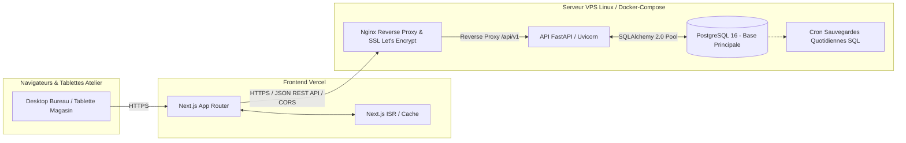
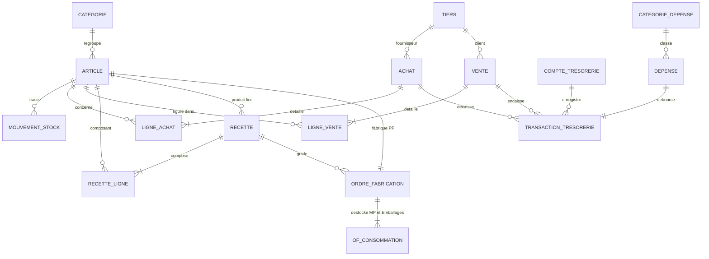

# ERP KEITALA — Dossier de Conception Technique & Architecture

---

## 1. Synthèse des Choix d'Architecture Validés

| Composant | Technologie & Rôle | Hébergement & Déploiement |
| :--- | :--- | :--- |
| **Frontend** | **Next.js (App Router, TypeScript, Tailwind CSS, Lucide Icons, TanStack Query)** | **Vercel** (Edge CDN, SSL automatique, CI/CD sur push Git) |
| **Backend API** | **Python (FastAPI, Pydantic v2, SQLAlchemy 2.0 async, Alembic)** | **VPS Linux** (Docker / Docker-Compose, Nginx reverse-proxy, SSL Certbot) |
| **Base de Données** | **PostgreSQL 16** | **VPS Linux** (Conteneur Docker persistant avec volumes managés & sauvegardes automatiques) |
| **Trésorerie** | **Caisse Espèces + Compte Banque** (sans Mobile Money) | Gérée via le module Trésorerie & Transactions |
| **Déstockage Production** | **Dual Déstockage Automatique (Matières Premières + Emballages)** | Validation atomique lors de la clôture des Ordres de Fabrication |

---

## 2. Architecture Globale du Système



### Configuration Réseau & Sécurité CORS
* Le backend FastAPI configurera le middleware CORS pour n'autoriser que le domaine Vercel de production (ex. `https://erp-keitala.vercel.app`) et `http://localhost:3000` pour le développement local.
* Les communications API entre Vercel et le VPS transitent via HTTPS chiffré (certificat SSL Let's Encrypt géré par Nginx sur le port 443 du VPS).
* Authentification stateless via **JSON Web Tokens (JWT)** avec refresh tokens sécurisés (`HttpOnly cookies`).

---

## 3. Schéma Relationnel de la Base de Données (PostgreSQL)



### Détail des Tables Clés

#### 1. `articles` (Catalogue unifié des 5 familles)
* `id` : UUID / BIGSERIAL (Clé Primaire)
* `code_sku` : VARCHAR(50) UNIQUE (ex. `KN-SOJ-CAF200`, `MP-SOJ-CON-SAC`)
* `designation` : VARCHAR(255)
* `famille` : ENUM (`SEMENCE`, `INTRANT`, `MATIERE_PREMIERE`, `EMBALLAGE`, `PRODUIT_FINI`)
* `unite_mesure` : VARCHAR(20) (`kg`, `sac_50kg`, `sachet_200g`, `bouteille_1l`, `unite`)
* `stock_actuel` : DECIMAL(15, 3) DEFAULT 0
* `stock_minimum` : DECIMAL(15, 3) DEFAULT 0
* `prix_achat_moyen` : DECIMAL(15, 2) DEFAULT 0 (PUMP)
* `prix_vente_standard` : DECIMAL(15, 2) DEFAULT 0
* `facteur_conversion_kg` : DECIMAL(10, 4) DEFAULT 1.0 (ex: 50.0 pour un sac de 50 kg)
* `est_actif` : BOOLEAN DEFAULT TRUE

#### 2. `mouvements_stock` (Livre journal des stocks)
* `id` : BIGSERIAL PRIMARY KEY
* `article_id` : FK -> `articles.id`
* `type_mouvement` : ENUM (`ENTREE_ACHAT`, `SORTIE_VENTE`, `CONSO_PRODUCTION`, `ENTREE_PRODUCTION`, `AJUSTEMENT_INVENTAIRE`, `SORTIE_DON_PERTE`)
* `quantite` : DECIMAL(15, 3) (positif pour entrée, négatif ou valeur absolue + type)
* `cout_unitaire` : DECIMAL(15, 2)
* `stock_avant` : DECIMAL(15, 3)
* `stock_apres` : DECIMAL(15, 3)
* `reference_document` : VARCHAR(100) (N° facture, N° OF, etc.)
* `date_mouvement` : TIMESTAMP WITH TIME ZONE DEFAULT NOW()
* `cree_par` : FK -> `utilisateurs.id`

#### 3. `recettes` & `lignes_recette` (Nomenclatures de transformation / BOM)
* `recettes` :
  * `id` : BIGSERIAL PRIMARY KEY
  * `article_produit_fini_id` : FK -> `articles.id`
  * `quantite_base` : DECIMAL(10, 2) DEFAULT 1.0 (ex. pour 1 sachet de Café de soja)
  * `description` : TEXT
* `lignes_recette` :
  * `id` : BIGSERIAL PRIMARY KEY
  * `recette_id` : FK -> `recettes.id`
  * `article_composant_id` : FK -> `articles.id` (Matière Première OU Emballage)
  * `quantite_necessaire` : DECIMAL(15, 4)
  * `type_composant` : ENUM (`MATIERE_PREMIERE`, `EMBALLAGE`, `ADDITIF`)

#### 4. `ordres_fabrication` (Pilotage de l'atelier)
* `id` : BIGSERIAL PRIMARY KEY
* `numero_of` : VARCHAR(50) UNIQUE (ex. `OF-2026-0001`)
* `recette_id` : FK -> `recettes.id`
* `article_pf_id` : FK -> `articles.id`
* `quantite_prevue` : DECIMAL(15, 2)
* `quantite_reelle_obtenue` : DECIMAL(15, 2)
* `quantite_chutes_dechets` : DECIMAL(15, 2) DEFAULT 0
* `statut` : ENUM (`BROUILLON`, `EN_COURS`, `TERMINE`, `ANNULE`)
* `date_lancement` : TIMESTAMP WITH TIME ZONE
* `date_cloture` : TIMESTAMP WITH TIME ZONE
* `responsable_id` : FK -> `utilisateurs.id`

#### 5. `comptes_tresorerie` & `transactions_tresorerie`
* `comptes_tresorerie` :
  * `id` : SERIAL PRIMARY KEY
  * `nom` : VARCHAR(100) (`Caisse Principale (Espèces)`, `Compte Bancaire`)
  * `code` : ENUM (`CAISSE`, `BANQUE`)
  * `solde_actuel` : DECIMAL(15, 2) DEFAULT 0
* `transactions_tresorerie` :
  * `id` : BIGSERIAL PRIMARY KEY
  * `compte_id` : FK -> `comptes_tresorerie.id`
  * `type_flux` : ENUM (`ENCAISSEMENT_VENTE`, `DECAISSEMENT_ACHAT`, `DEPENSE_EXPLOITATION`, `TRANSFERT_INTERNE`)
  * `montant` : DECIMAL(15, 2) NOT NULL (Contrainte > 0)
  * `date_transaction` : TIMESTAMP WITH TIME ZONE DEFAULT NOW()
  * `libelle` : VARCHAR(255)
  * `piece_reference` : VARCHAR(100)
  * `compte_destination_id` : FK -> `comptes_tresorerie.id` (pour transferts Banque <-> Caisse)

---

## 4. Spécification des Endpoints API REST (FastAPI)

Tous les endpoints sont préfixés par `/api/v1` et retournent des réponses normalisées JSON.

```
/api/v1
│
├── /auth
│   ├── POST /login               # Authentification JWT
│   └── GET  /me                  # Profil utilisateur connecté
│
├── /articles
│   ├── GET    /                  # Liste filtrable (famille, seuil bas, recherche)
│   ├── POST   /                  # Création d'article (semence, MP, PF, emballage)
│   ├── GET    /{id}              # Fiche article & historique
│   └── PUT    /{id}              # Modification (prix, seuils)
│
├── /stocks
│   ├── GET    /etat-global       # Synthèse des stocks par famille & alertes
│   ├── GET    /mouvements        # Journal complet des mouvements
│   ├── POST   /ajustement        # Régularisation inventaire
│   └── GET    /alertes-rupture   # Liste des articles sous le seuil minimum
│
├── /achats
│   ├── GET    /                  # Liste des achats (semences, céréales, emballages)
│   └── POST   /                  # Création achat (incrémente stock + décaisse Caisse/Banque)
│
├── /ventes
│   ├── GET    /                  # Historique des ventes & factures
│   ├── POST   /                  # Création vente (déstocke article + encaisse Caisse/Banque)
│   ├── GET    /{id}/facture-pdf  # Génération PDF de la facture
│   └── POST   /dons              # Déstockage dons/échantillons (sans encaissement)
│
├── /production
│   ├── GET    /recettes          # Liste des fiches recettes (BOM)
│   ├── POST   /recettes          # Création de fiche recette
│   ├── GET    /ordres            # Liste des Ordres de Fabrication
│   ├── POST   /ordres            # Lancement d'un OF
│   └── POST   /ordres/{id}/cloture # Clôture OF (déstocke MP+Emballages, stocke PF)
│
├── /tresorerie
│   ├── GET    /soldes            # Soldes en temps réel (Caisse + Banque)
│   ├── GET    /journal           # Journal des écritures financières
│   ├── POST   /transfert         # Virement interne Banque <-> Caisse
│   ├── POST   /depenses          # Saisie dépense (main d'œuvre, carburant, etc.)
│   └── GET    /depenses          # Historique et filtres analytiques
│
└── /dashboard
    └── GET    /kpis              # CA du jour/mois, valeur stock, alertes, marge
```

---

## 5. Structure & Ergonomie du Frontend (Next.js)

Le frontend utilisera le système d'onglets et de pages épurées, conçu pour une utilisation facile au bureau ou sur tablette :

* **/dashboard** : Vue 360° (Solde Caisse, Solde Banque, Alertes de stock bas, CA du jour, OF en cours).
* **/stocks** : Vue segmentée par onglets :
  * 🌾 *Semences Agricoles*
  * 📦 *Intrants & Emballages*
  * 🌽 *Matières Premières & Céréales*
  * 🏷️ *Produits Finis*
  * 🔄 *Journal des Mouvements* & *Inventaire*
* **/production** :
  * Tableau des OF en cours / terminés
  * Formulaire de clôture avec déstockage automatique assisté
  * Gestionnaire des fiches recettes (composition MP + Emballage)
* **/ventes** :
  * Caisse / Point de vente rapide (sélection client, ajout d'articles avec recherche instantanée, mode de règlement Caisse/Banque).
  * Ventes en gros (semences, céréales).
  * Registre des dons et échantillons.
* **/achats** :
  * Saisie des réceptions de grains, semences et emballages.
* **/tresorerie** :
  * Écran Caisse & Banque avec graphique des flux.
  * Formulaire de dépenses avec catégories strictes et confirmation anti-erreur.

---

## 6. Guide de Déploiement Production (Vercel + VPS)

### A. Déploiement VPS Linux (Backend & Database)
Un fichier `docker-compose.yml` standardisé sur le VPS contiendra :
1. **Conteneur `db`** : Image officielle `postgres:16-alpine` avec volume persistant `pgdata`.
2. **Conteneur `backend`** : Image Docker FastAPI (Python 3.11), port exposé `8000`.
3. **Conteneur `nginx`** : Reverse proxy gérant le certificat SSL Let's Encrypt et redirigeant `https://api.keitala-erp.com/api` vers le port 8000.

### B. Déploiement Vercel (Frontend)
1. Dépôt GitHub connecté à Vercel.
2. Variable d'environnement Vercel :
   ```env
   NEXT_PUBLIC_API_URL=https://api.keitala-erp.com/api/v1
   ```
3. Déploiement automatique à chaque `git push`.
