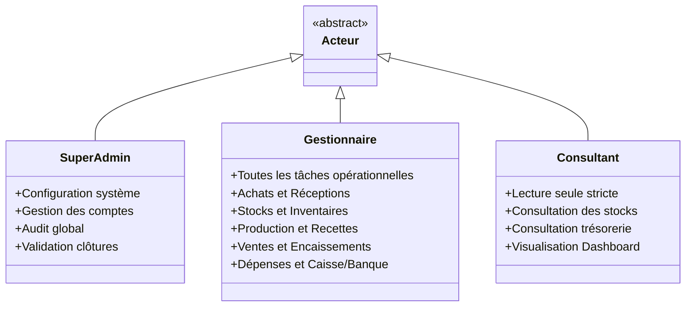
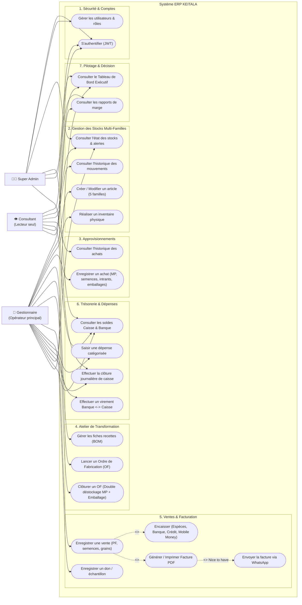
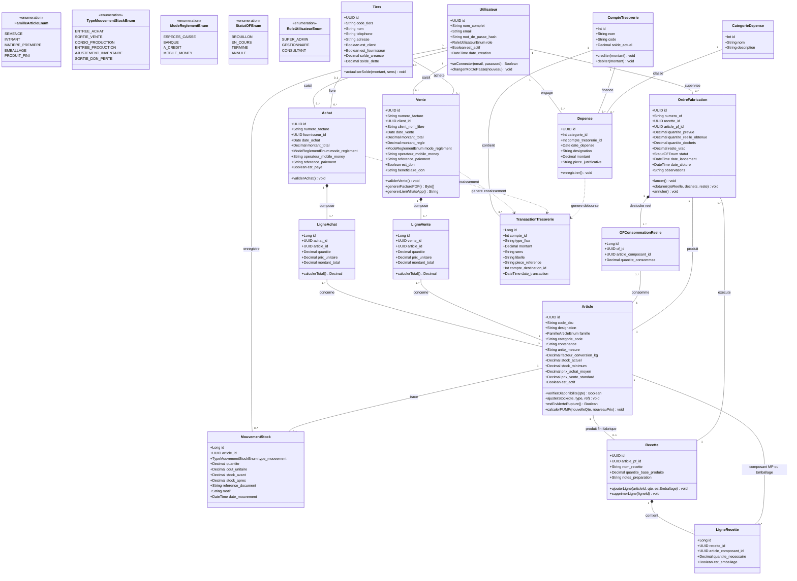

# ERP KEITALA — Dossier de Conception UML

Ce document présente la modélisation UML demandée pour l'ERP KEITALA, centrée sur les **3 acteurs définis** et les flux opérationnels de l'entreprise.

---

## 1. Rappel des Acteurs du Système

* **Super Admin** : Responsable / Gérance disposant de l'intégralité des privilèges, de l'administration des utilisateurs et de la validation stratégique.
* **Gestionnaire** : L'acteur central au quotidien qui réalise **toutes les opérations de saisie et de traitement** (stocks, achats, fabrication, vente comptoir, dépenses, transferts).
* **Consultant** : Observateur (associé, auditeur, contrôleur) disposant d'un droit de consultation étendu mais d'**aucune action modificatrice**.

---

## 2. Diagramme des Cas d'Utilisation (Use Case Diagram)

---

## 3. Matrice des Rôles et Cas d'Utilisation

| Module | Cas d'Utilisation | Super Admin | Gestionnaire | Consultant |
| :--- | :--- | :---: | :---: | :---: |
| **Sécurité** | S'authentifier | ✅ | ✅ | ✅ |
| | Gérer les utilisateurs et profils | ✅ | ❌ | ❌ |
| **Stocks** | Consulter les stocks & alertes | ✅ | ✅ | ✅ *(Lecture)* |
| | Créer / Modifier articles | ✅ | ✅ | ❌ |
| | Réaliser un inventaire / ajustement | ✅ *(Validation)* | ✅ *(Saisie)* | ❌ |
| | Consulter le journal d'audit des stocks | ✅ | ✅ | ✅ *(Lecture)* |
| **Achats** | Enregistrer un achat | ❌ | ✅ | ❌ |
| | Consulter l'historique des achats | ✅ | ✅ | ✅ *(Lecture)* |
| **Production** | Gérer les recettes (BOM) | ✅ | ✅ | ❌ |
| | Lancer un Ordre de Fabrication (OF) | ❌ | ✅ | ❌ |
| | Clôturer un OF (Double déstockage) | ❌ | ✅ | ❌ |
| **Ventes** | Enregistrer une vente & encaissement | ❌ | ✅ | ❌ |
| | Générer / Imprimer facture PDF | ✅ | ✅ | ✅ *(Lecture)* |
| | Envoyer facture via WhatsApp *(Nice to have)* | ✅ | ✅ | ❌ |
| | Enregistrer un don / échantillon | ❌ | ✅ | ❌ |
| **Trésorerie** | Consulter soldes Caisse & Banque | ✅ | ✅ | ✅ *(Lecture)* |
| | Saisir une dépense d'exploitation | ❌ | ✅ | ❌ |
| | Virement interne Banque $\leftrightarrow$ Caisse | ✅ *(Validation)* | ✅ *(Exécution)* | ❌ |
| | Clôture de caisse (billetage) | ✅ *(Validation)* | ✅ *(Saisie)* | ❌ |
| **Pilotage** | Dashboard exécutif & KPIs | ✅ | ✅ | ✅ *(Lecture)* |
| | Rapports de marges par produit | ✅ | ✅ | ✅ *(Lecture)* |

---

## 4. Diagramme de Classes (Class Diagram)

---

## 5. Description Détaillée des Relations & Comportements Métier

### 5.1 Gestion des Stocks & Mouvements
* Tout mouvement physique sur un `Article` entraîne obligatoirement la création d'un enregistrement immuable dans `MouvementStock`.
* Les types de mouvements garantissent la traçabilité intégrale :
  * `ENTREE_ACHAT` : Lié à un `Achat` validé.
  * `SORTIE_VENTE` : Lié à une `Vente` validée.
  * `CONSO_PRODUCTION` : Déstockage automatique des matières premières et emballages lors de la validation d'un `OrdreFabrication`.
  * `ENTREE_PRODUCTION` : Entrée du lot de produits finis issu de l'OF.
  * `SORTIE_DON_PERTE` : Sortie sans contrepartie financière (dégustation, don ou avarie).
  * `AJUSTEMENT_INVENTAIRE` : Écart physique régularisé.

### 5.2 Recette et Double Déstockage (Production)
* Une `Recette` est une nomenclature (BOM) reliant un produit fini à ses composants via `LigneRecette`.
* L'indicateur `est_emballage` (Booléen) permet de différencier :
  * Les **Matières Premières agricoles** (ex: Graine de soja, fonio, arachide).
  * Les **Consommables de conditionnement** (ex: Sachet 200g, sachet 1kg, bouteille 1L).
* Lors de la clôture de l'`OrdreFabrication` :
  1. La méthode `cloturer()` déduit le stock des composants proportionnellement aux quantités produites.
  2. Elle incrémente le stock de l'`Article` produit fini.
  3. Elle enregistre les consommations réelles dans `OFConsommationReelle`.

### 5.3 Ventes, Règlements & Option WhatsApp
* Une `Vente` comporte plusieurs `LigneVente` associées à des `Article` (qui peuvent être des produits finis, des semences ou des grains bruts).
* Modes de règlement gérés :
  * `ESPECES_CAISSE` : Déclenche immédiatement un crédit sur le `CompteTresorerie` Caisse.
  * `BANQUE` : Déclenche un crédit sur le `CompteTresorerie` Banque.
  * `MOBILE_MONEY` : Enregistre le montant avec le libellé libre de l'opérateur (Wave, Orange Money...) et le N° de transaction.
  * `A_CREDIT` : Augmente le `solde_creance` du `Tiers` client sans flux de caisse immédiat.
* **Option WhatsApp** :
  * La méthode `genererLienWhatsApp()` concatène le numéro de téléphone du client et un message URL-encodé reprenant le numéro de facture, la liste des articles achetés, le montant total et un lien vers le reçu numérique, permettant un envoi direct en 1 clic.
