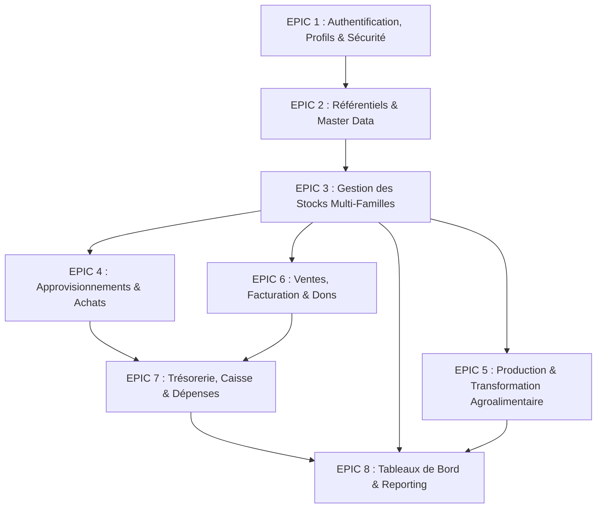

# ERP KEITALA — Product Backlog Complet

---

## 1. Définition des Rôles & Acteurs du Système

Le système est configuré autour de **3 profils utilisateurs exclusifs** :

| Rôle | Description & Périmètre de Responsabilité | Droits d'Accès |
| :--- | :--- | :--- |
| **Super Admin** | Propriétaire / Directrice de l'entreprise ou Responsable IT. | **Contrôle total** : configuration générale, gestion des comptes utilisateurs, modification des règles métier, audit, suppression exceptionnelle et validation globale. |
| **Gestionnaire** | Opérateur principal de l'application au quotidien ("la personne qui fait toutes les tâches"). | **Lecture / Écriture / Exécution** : saisie des achats, gestion des stocks, recettes et ordres de fabrication, ventes, encaissements, saisie des dépenses, transferts caisse/banque. |
| **Consultant** | Observateur, auditeur ou associé ("1 pour consulter"). | **Lecture seule stricte** : visualisation des tableaux de bord, consultation des niveaux de stocks, historique des ventes, achats et trésorerie. Aucun droit d'ajout, de modification ou de suppression. |

---

## 2. Vue d'Ensemble des Épics

---

## 3. Détail des User Stories par Épic

---

### EPIC 1 : Authentification, Profils & Sécurité

#### US-AUTH-01 : Connexion sécurisée
* **En tant que** : Tout utilisateur (Super Admin, Gestionnaire, Consultant)
* **Je veux** : M'authentifier avec mon email et mot de passe sécurisé
* **Afin de** : Accéder à mon espace de travail selon mes permissions
* **Critères d'acceptation** :
  * Écran de connexion épuré avec messages d'erreurs clairs en cas d'identifiants incorrects.
  * Génération d'un token JWT sécurisé avec expiration configurable.
  * Redirection automatique vers le Dashboard adapté au profil.
* **Priorité** : **Must Have**

#### US-AUTH-02 : Gestion des comptes utilisateurs
* **En tant que** : Super Admin
* **Je veux** : Créer, activer, désactiver ou modifier les comptes utilisateurs et leur attribuer l'un des 3 rôles
* **Afin de** : Contrôler rigoureusement qui accède aux données de l'entreprise
* **Critères d'acceptation** :
  * Liste des utilisateurs avec statut (Actif/Inactif) et rôle affiché.
  * Impossible de créer un rôle autre que les 3 rôles définis.
  * Réinitialisation de mot de passe disponible pour l'Admin.
* **Priorité** : **Must Have**

#### US-AUTH-03 : Cloisonnement strict des droits (RBAC)
* **En tant que** : Consultant
* **Je veux** : Consulter tous les écrans sans voir les boutons d'action (Ajouter, Modifier, Supprimer, Valider)
* **Afin de** : Préserver l'intégrité absolue des données contre toute fausse manipulation
* **Critères d'acceptation** :
  * Masquage visuel des boutons d'action pour le Consultant.
  * Sécurité au niveau de l'API Backend (FastAPI rejette en code 403 toute requête POST/PUT/DELETE venant d'un Consultant).
* **Priorité** : **Must Have**

---

### EPIC 2 : Référentiels & Master Data

#### US-REF-01 : Gestion du répertoire des Tiers (Clients & Fournisseurs)
* **En tant que** : Gestionnaire
* **Je veux** : Enregistrer et mettre à jour les coordonnées des clients et des fournisseurs (Nom, Téléphone, Adresse)
* **Afin de** : Éviter les doublons et normaliser les informations de facturation
* **Critères d'acceptation** :
  * Fiche tiers avec case à cocher "Client" et/ou "Fournisseur".
  * Affichage du solde en cours (créance due par le client ou dette due au fournisseur).
* **Priorité** : **Must Have**

#### US-REF-02 : Paramétrage des unités et conversions automatiques
* **En tant que** : Super Admin
* **Je veux** : Définir les unités de mesure et leurs coefficients de conversion (ex: 1 Sac = 50 kg)
* **Afin que** : Le Gestionnaire puisse manipuler des sacs ou des kilogrammes sans fausser les stocks
* **Critères d'acceptation** :
  * Table de conversion paramétrable : `1 sac_50kg = 50 kg`.
  * Prise en compte dans tous les formulaires d'achats, ventes et transformation.
* **Priorité** : **Must Have**

---

### EPIC 3 : Gestion Complète des Stocks Multi-Familles

#### US-STK-01 : Catalogue des articles classés par famille
* **En tant que** : Gestionnaire
* **Je veux** : Créer et classifier les articles selon les 5 familles prédéfinies :
  1. *Semences Agricoles* (Soja semence kg/sac)
  2. *Intrants Agricoles & Traitement* (engrais, produits phyto, sacs de stockage)
  3. *Matières Premières & Récoltes Brutes* (Soja grain, Maïs, Mil, Fonio brut, Pâte de manioc)
  4. *Emballages & Conditionnement* (sachets 200g, 400g, 500g, 1kg, bouteilles, étiquettes)
  5. *Produits Finis Transformés* (Café de soja, Soumbala, Gari, Attiéké, Tapioka...)
* **Afin de** : Disposer d'une vision nette et organisée de l'ensemble du patrimoine physique
* **Critères d'acceptation** :
  * Chaque article a un code SKU unique (ex: `KN-SOJ-CAF200`).
  * Définition d'un prix d'achat moyen (PUMP) et d'un prix de vente standard.
  * Définition d'un seuil de stock minimum d'alerte.
* **Priorité** : **Must Have**

#### US-STK-02 : Consultation filtrée des stocks & valorisation
* **En tant que** : Gestionnaire ou Consultant
* **Je veux** : Visualiser l'état des stocks en temps réel avec filtres par famille et recherche textuelle
* **Afin de** : Connaître les quantités disponibles et la valeur financière totale du stock
* **Critères d'acceptation** :
  * Onglets par famille d'articles.
  * Affichage de : Quantité en stock, Unité, Valeur unitaire PUMP, Valeur totale du stock.
  * Indicateur visuel couleur (Vert = OK, Rouge = Stock bas sous le minimum).
* **Priorité** : **Must Have**

#### US-STK-03 : Alertes automatiques de réapprovisionnement
* **En tant que** : Gestionnaire ou Consultant
* **Je veux** : Être alerté dès qu'un article franchit son seuil minimum
* **Afin de** : Déclencher les approvisionnements à temps et éviter toute rupture
* **Critères d'acceptation** :
  * Badge d'alerte sur le Dashboard principal avec le nombre d'articles en alerte.
  * Page dédiée listant les articles critiques à réapprovisionner.
* **Priorité** : **Must Have**

#### US-STK-04 : Inventaire physique & Régularisation des écarts
* **En tant que** : Gestionnaire (avec validation Super Admin)
* **Je veux** : Saisir les quantités physiques réelles constatées lors d'un comptage et enregistrer les ajustements
* **Afin de** : Aligner le stock informatique sur la réalité physique (avaries, pertes au séchage)
* **Critères d'acceptation** :
  * Saisie de la quantité réelle et calcul automatique de l'écart.
  * Motif d'ajustement obligatoire (Casse, Avarie, Dessiccation, Erreur comptage).
  * Génération automatique d'une ligne d'ajustement dans le journal des mouvements.
* **Priorité** : **Should Have**

#### US-STK-05 : Journal d'audit des mouvements de stock
* **En tant que** : Consultant ou Super Admin
* **Je veux** : Consulter l'historique chronologique complet de chaque mouvement de stock
* **Afin de** : Tracer l'origine exacte de toute entrée ou sortie
* **Critères d'acceptation** :
  * Colonnes : Date/Heure, Article, Type (Entrée achat, Sortie vente, Conso OF, Entrée OF, Ajustement), Quantité, Stock Avant, Stock Après, Pièce de référence, Auteur.
  * Filtre par date et par article.
* **Priorité** : **Must Have**

---

### EPIC 4 : Approvisionnements & Achats

#### US-ACH-01 : Enregistrement d'un achat avec imputation automatique
* **En tant que** : Gestionnaire
* **Je veux** : Enregistrer une réception d'achats (Matières premières, semences, intrants ou emballages)
* **Afin que** : Le stock soit incrémenté immédiatement et la dépense imputée sur la caisse, la banque ou le compte adéquat
* **Critères d'acceptation** :
  * Sélection du fournisseur (ou saisie libre).
  * Ajout multi-articles avec quantité et prix d'achat unitaire.
  * Choix du mode de règlement : 
    * **Espèces (Caisse)**
    * **Banque**
    * **À crédit**
    * **Mobile Money** (avec champ de saisie libre pour préciser le type/opérateur : Wave, Orange Money, Moov, etc. et référence éventuelle).
  * Incrémentation atomique du stock des articles achetés.
  * Recalcul automatique du PUMP de chaque article.
* **Priorité** : **Must Have**

#### US-ACH-02 : Historique des achats & Factures fournisseurs
* **En tant que** : Gestionnaire ou Consultant
* **Je veux** : Consulter la liste de tous les achats passés avec filtre par fournisseur et période
* **Afin de** : Vérifier les dépenses d'approvisionnement et justifier les pièces comptables
* **Critères d'acceptation** :
  * Liste détaillée avec N° de facture/bordereau, date, montant, mode de règlement.
  * Fiche détail visualisable pour chaque achat.
* **Priorité** : **Must Have**

---

### EPIC 5 : Production & Transformation Agroalimentaire

#### US-PROD-01 : Fiches Recettes / Nomenclatures (Bill of Materials)
* **En tant que** : Gestionnaire
* **Je veux** : Créer et modifier les recettes de fabrication associant les matières premières et les emballages requis
* **Afin de** : Standardiser le processus de production
* **Critères d'acceptation** :
  * Sélection du produit fini cible (ex: *Djouka 1 kg* ou *Café de soja 200g*).
  * Ajout des ingrédients nécessaires :
    * Matières premières (ex: 0.43 kg Fonio brut + 0.72 kg Arachide).
    * Emballage obligatoire (ex: 1 sachet imprimé 1 kg).
* **Priorité** : **Must Have**

#### US-PROD-02 : Création & Lancement d'un Ordre de Fabrication (OF)
* **En tant que** : Gestionnaire
* **Je veux** : Lancer un OF en précisant la recette et le nombre d'unités cibles à fabriquer
* **Afin de** : Planifier le travail de l'atelier et vérifier la disponibilité des matières
* **Critères d'acceptation** :
  * Attribution d'un numéro unique automatique (`OF-2026-XXXX`).
  * Calcul prévisionnel des besoins en matières premières et en emballages.
  * Message d'alerte si le stock d'ingrédients ou d'emballages est insuffisant pour honorer l'OF.
* **Priorité** : **Must Have**

#### US-PROD-03 : Clôture d'OF avec Double Déstockage Automatique
* **En tant que** : Gestionnaire
* **Je veux** : Valider la fin d'une fabrication en saisissant les quantités réelles obtenues et les pertes
* **Afin que** : Le système déstocke automatiquement les MP ET les emballages, et incrémente le stock de PF
* **Critères d'acceptation** :
  * Saisie de la quantité nette produite (nombre de sachets/bouteilles conformes).
  * Saisie des chutes/pertes ou restes en vrac.
  * Déstockage automatique et proportionnel des matières premières consommées.
  * Déstockage automatique du nombre d'emballages/sachets utilisés.
  * Entrée immédiate en stock du Produit Fini prêt à la vente.
  * Statut de l'OF passant à `TERMINE`.
* **Priorité** : **Must Have**

---

### EPIC 6 : Ventes, Facturation & Sorties Non Commerciales

#### US-VTE-01 : Saisie rapide de vente (Comptoir & Gros)
* **En tant que** : Gestionnaire
* **Je veux** : Enregistrer une vente en quelques clics en sélectionnant les articles et les quantités
* **Afin de** : Servir le client rapidement, déstocker l'article et encaisser le montant
* **Critères d'acceptation** :
  * Possibilité de vendre des **Produits Finis**, mais aussi des **Semences** ou des **Grains bruts**.
  * Recherche instantanée d'articles avec prix unitaire pré-rempli (modifiable).
  * Sélection du client ou "Client comptoir / de passage".
  * Déstockage immédiat des articles vendus.
  * Blocage si stock insuffisant (avec alerte explicite).
* **Priorité** : **Must Have**

#### US-VTE-02 : Modes de paiement & Encaissement automatique
* **En tant que** : Gestionnaire
* **Je veux** : Choisir le règlement par **Espèces (Caisse)**, **Banque**, **À crédit**, ou **Mobile Money** (avec saisie libre de l'opérateur)
* **Afin que** : Le mode de paiement exact soit enregistré et la trésorerie actualisée
* **Critères d'acceptation** :
  * Si **Espèces (Caisse)** $\rightarrow$ Crédit immédiat de la Caisse Principale.
  * Si **Banque** $\rightarrow$ Crédit immédiat du Compte Bancaire.
  * Si **Mobile Money** $\rightarrow$ Champ texte libre pour saisir le type/opérateur (ex. *Wave*, *Orange Money*, *Moov*) et le N° de transaction/téléphone de référence.
  * Si **À crédit** $\rightarrow$ Incrémentation de la créance sur la fiche du client.
* **Priorité** : **Must Have**

#### US-VTE-03 : Génération, Impression et Envoi de Facture / Reçu
* **En tant que** : Gestionnaire ou Consultant
* **Je veux** : Générer une facture proforma ou définitive, l'imprimer en PDF et pouvoir l'envoyer au client
* **Afin de** : La remettre au client en main propre ou par voie électronique
* **Critères d'acceptation** :
  * N° unique incrémental (`FAC-2026-XXXX`).
  * Détail des lignes, sous-total, mode de règlement (avec mention du Mobile Money et de l'opérateur si applicable) et solde restant.
  * Bouton "Télécharger PDF" ou "Imprimer".
  * **Option Nice to Have (Could Have)** : Bouton "Envoyer par WhatsApp" générant automatiquement un lien direct (`https://wa.me/<tel>?text=...`) pré-rempli avec le résumé de la facture et le lien d'accès/téléchargement du reçu pour transmission immédiate sur le téléphone du client.
* **Priorité** : **Must Have** (avec composante WhatsApp en **Could Have**)

#### US-VTE-04 : Gestion des Sorties Spéciales (Dons & Échantillons)
* **En tant que** : Gestionnaire
* **Je veux** : Enregistrer des sorties de produits pour dégustation, dons ou promotion
* **Afin de** : Déstocker physiquement les articles sans créer de créance ni d'attente financière
* **Critères d'acceptation** :
  * Case "Don / Échantillon" activable lors de la sortie.
  * Saisie obligatoire du bénéficiaire et du motif.
  * Impacte le stock mais génère un montant financier de 0 FCFA.
* **Priorité** : **Must Have**

---

### EPIC 7 : Trésorerie, Caisse & Dépenses d'Exploitation

#### US-TRES-01 : Consultation en temps réel des soldes de Trésorerie
* **En tant que** : Gestionnaire ou Consultant
* **Je veux** : Connaître instantanément le solde de la Caisse Espèces et du Compte Bancaire
* **Afin de** : Savoir exactement de quelles liquidités dispose l'entreprise
* **Critères d'acceptation** :
  * Cartes d'indicateurs bien visibles : Solde Caisse et Solde Banque.
  * Historique des dernières entrées et sorties.
* **Priorité** : **Must Have**

#### US-TRES-02 : Enregistrement des dépenses courantes catégorisées
* **En tant que** : Gestionnaire
* **Je veux** : Saisir les dépenses quotidiennes en précisant la catégorie, le montant et la pièce justificative
* **Afin de** : Suivre les charges d'exploitation sans mélange
* **Critères d'acceptation** :
  * Catégories conformes à l'Excel : *Main d'œuvre / Personnel*, *Entretien & Réparations*, *Emballages*, *Carburant / Transport*, *Retrait Personnel / Avance*, *Fournitures & Hygiène*.
  * Choix du compte payeur : Caisse ou Banque.
  * Masque de saisie avec confirmation pour les montants élevés afin d'interdire les fautes de frappe (ex: 20 millions au lieu de 2 millions).
* **Priorité** : **Must Have**

#### US-TRES-03 : Transfert Interne (Alimentation de Caisse via Banque)
* **En tant que** : Gestionnaire
* **Je veux** : Enregistrer un retrait bancaire pour alimenter la caisse espèces (ou un versement d'espèces à la banque)
* **Afin que** : Les deux comptes soient ajustés dans une même transaction équilibrée
* **Critères d'acceptation** :
  * Débit du compte source et crédit du compte destinataire du même montant.
  * Aucun impact sur le compte de résultat (transfert neutre).
* **Priorité** : **Must Have**

#### US-TRES-04 : Clôture journalière de Caisse (Billetage)
* **En tant que** : Gestionnaire (validé par Super Admin)
* **Je veux** : Réaliser la clôture de caisse quotidienne en comptant les espèces physiques
* **Afin de** : Vérifier la concordance entre le solde théorique et le tiroir-caisse
* **Critères d'acceptation** :
  * Récapitulatif : Solde d'ouverture + Total Encaissements du jour - Total Dépenses du jour = Solde théorique.
  * Saisie du montant physique constaté et calcul automatique de l'écart éventuel.
* **Priorité** : **Should Have**

---

### EPIC 8 : Tableaux de Bord & Reporting

#### US-DASH-01 : Tableau de bord exécutif synthétique
* **En tant que** : Super Admin ou Consultant
* **Je veux** : Avoir un tableau de bord visuel résumant la performance de l'entreprise
* **Afin de** : Piloter l'activité en un coup d'œil
* **Critères d'acceptation** :
  * KPIs affichés : Chiffre d'Affaires du jour/mois, Valeur totale du stock, Solde Caisse + Banque, Nombre d'articles en alerte rupture, Nombre d'OF en cours.
  * Graphique d'évolution des ventes sur 30 jours.
* **Priorité** : **Must Have**

#### US-DASH-02 : Rapport des marges et rentabilité par produit
* **En tant que** : Super Admin ou Consultant
* **Je veux** : Visualiser la marge brute réalisée sur chaque produit fini et sur les ventes de semences/matières
* **Afin d'** : Identifier les produits les plus rentables
* **Critères d'acceptation** :
  * Tableau : Produit, Quantité vendue, CA réalisé, Coût de revient (PUMP/MP), Marge Brute en FCFA et en %.
* **Priorité** : **Should Have**

#### US-DASH-03 : Export des données et rapports (Excel / PDF)
* **En tant que** : Consultant ou Super Admin
* **Je veux** : Exporter les états de stocks, les journaux de caisse et l'historique des ventes
* **Afin de** : Partager les données ou faire des analyses externes
* **Critères d'acceptation** :
  * Bouton "Exporter Excel (.xlsx)" et "Exporter PDF" sur chaque grand tableau.
* **Priorité** : **Could Have**

---

## 4. Matrice de Traçabilité des Rôles (RACI / Droits)

| Module / Fonctionnalité | Super Admin | Gestionnaire (Tâches) | Consultant |
| :--- | :---: | :---: | :---: |
| **Gestion des utilisateurs & rôles** | **Créer / Modifier** | ❌ Aucun accès | ❌ Aucun accès |
| **Création d'articles & seuils stocks** | **Valider / Modifier** | **Créer / Modifier** | 👁️ Consulter seul |
| **Saisie des Achats & Réceptions** | 👁️ Consulter | **Saisir / Valider** | 👁️ Consulter seul |
| **Recettes & Ordres de Fabrication** | 👁️ Consulter | **Gérer / Clôturer** | 👁️ Consulter seul |
| **Ventes, Facturation & Dons** | 👁️ Consulter | **Vendre / Encaisser** | 👁️ Consulter seul |
| **Saisie Dépenses & Transferts** | **Valider si > seuil** | **Saisir au quotidien** | 👁️ Consulter seul |
| **Clôture Journalière de Caisse** | **Validation finale** | **Saisie billetage** | 👁️ Consulter seul |
| **Tableaux de bord & Reporting** | 👁️ Accès complet | 👁️ Accès complet | 👁️ Accès complet |
