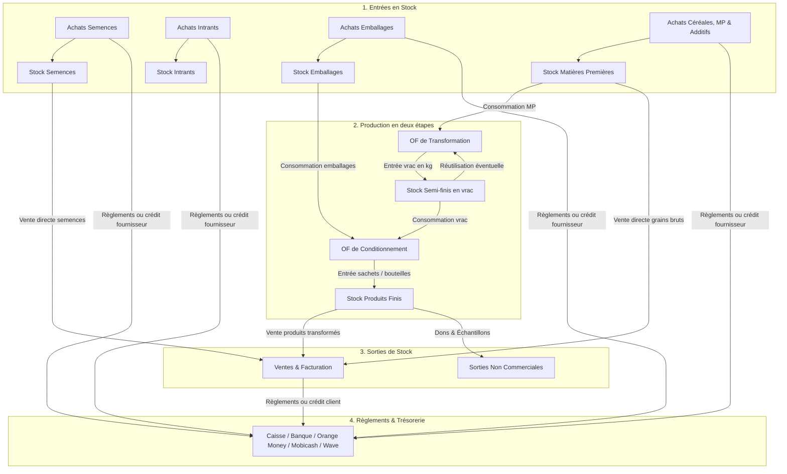
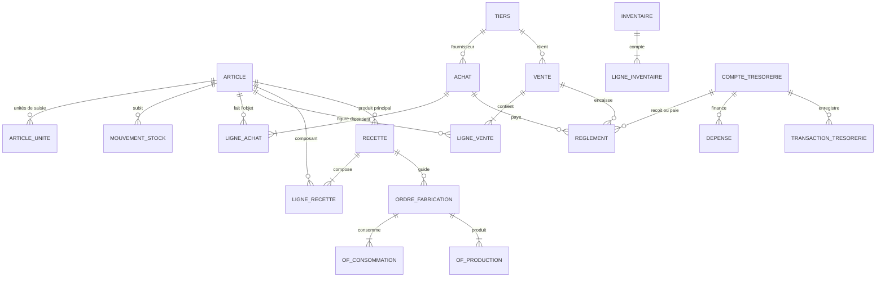

# ERP KEITALA — Dossier d'Analyse, de Spécification des Besoins & de Conception

**Version 1.1** — aligné sur `schema.sql` v1.1, le backlog, le dossier UML et la conception technique.

---

## 1. Contexte & Diagnostic de l'Existant

### 1.1 Présentation de l'Entreprise
**KEITALA** est une entreprise agroalimentaire et commerciale qui travaille dans la production et la transformation agricole, ainsi que dans les intrants et les semences :
1. **Le stockage, l'approvisionnement et la commercialisation de produits agricoles bruts, semences et intrants** (semences sélectionnées de soja/maïs, grains de consommation, emballages et intrants).
2. **La transformation agroalimentaire locale, le conditionnement et la vente** (café de soja, soumbala, attiéké, gari, tapioka, djouka, fonio, farines et huiles).

Zone économique : Afrique de l'Ouest (zone UEMOA / devise : **Franc CFA - FCFA**).

### 1.2 Périmètre
* **Dans le périmètre** : stocks, achats, transformation et conditionnement, ventes et dons, trésorerie et dépenses, tableaux de bord.
* **Hors périmètre** : le suivi des champs, des parcelles et des campagnes agricoles. L'ERP commence à l'entrée en stock de la marchandise (achat ou récolte reçue au magasin).
* **Fonctionnement** : application **100 % en ligne**, sans mode hors connexion.

### 1.3 Analyse du Fichier Source (`ERP_Keitala.xlsx`)
L'analyse des 17 feuilles Excel met en évidence les points suivants :

* **Feuille `Matieres_Premieres`** :
  * Semences agricoles : `Soja Semence`, géré sous deux codes (`MP-SOJ-SEM-KG` et `MP-SOJ-SEM-SAC` de 50 kg), prix de vente 1 000 FCFA/kg.
  * Céréales de consommation : `Soja Consommation`, `Maïs`, `Mil`, `Pâte de Manioc`, chacun sous deux codes (kg et sac de 50 kg).
* **Feuilles `Achats` et `Ventes`** :
  * Les matières premières et semences sont achetées en gros (7 000 kg de graine de soja à 290 FCFA) et vendues directement (10 000 kg à 320 FCFA) sans transformation.
  * Les produits finis sont vendus en sachets et bouteilles (café de soja, gari).
* **Feuille `Production`** :
  * Une même matière donne plusieurs produits (la pâte de manioc sort en tapioka petit et gros), parfois sur plusieurs jours pour un même lot.
  * Des produits intermédiaires existent (le fonio précuit est ensuite transformé en djouka).
  * Les rendements varient (64,74 kg de pâte donnent 48,26 kg d'attiéké) et il reste du vrac après ensachage.
* **Feuille `Depenses`** :
  * Petits achats de consommables (packs d'emballages, produits d'entretien, carburant).
* **Anomalies constatées dans l'Excel** :
  * Formules de stock cassées (`#NAME?`) : `SUMIF` et `SOMME.SI` sont mélangées dans les mêmes colonnes.
  * Erreur de saisie en caisse : l'achat de soja est sorti pour `20 030 000` FCFA alors que 7 000 kg × 290 font `2 030 000`.
  * Stock de soja négatif : 10 000 kg vendus pour 7 000 kg achetés et un stock initial nul.
  * Stocks initiaux contradictoires entre feuilles (SANI 500 g : 11 dans `Produits_Finis`, 2 dans `Stock_Produits_Finis`).
  * Quantités de production saisies en texte (`11,38 kg`), dates tantôt en texte tantôt en date, dépense sans catégorie.
  * Aucune conversion entre sacs de 50 kg et kilogrammes, aucun suivi des emballages.

**Conséquence** : les stocks de l'Excel ne sont pas repris. Le démarrage se fait sur un **inventaire physique**.

---

## 2. Architecture Globale des Flux Métier

---

## 3. Spécifications Détaillées des Modules

### Module 1 : Gestion des Stocks Multi-Familles (Cœur du Système)

Le système segmente les stocks en **6 familles d'articles** :

| Famille d'Article | Description & Exemples | Unité de base | Types de mouvements autorisés |
| :--- | :--- | :--- | :--- |
| **1. Semences Agricoles** | Semences sélectionnées et certifiées (soja semence, maïs semence) destinées à la vente ou à la réserve. | kg (saisie possible en sac de 50 kg) | Entrée achat, Sortie vente, Sortie don, Ajustement inventaire, Perte. |
| **2. Intrants Agricoles & Traitement** | Produits de traitement des grains et semences, fertilisants, produits de conservation, sacs vides. | Sac, Litre, Flacon, Unité | Entrée achat, Sortie vente éventuelle, Ajustement, Perte. |
| **3. Matières Premières** | Grains et tubercules bruts (soja consommation, maïs, mil, fonio brut, pâte de manioc, arachide), ingrédients et additifs (bicarbonate, potasse). | kg (saisie possible en sac de 50 kg) | Entrée achat, Consommation en transformation, Sortie vente en vrac, Ajustement, Perte. |
| **4. Semi-finis (vrac)** | Produits transformés avant ensachage (attiéké vrac, tapioka vrac, fonio précuit, djouka vrac). | kg ou Litre | Entrée production (transformation), Consommation en conditionnement ou en transformation, Ajustement, Perte. |
| **5. Emballages & Conditionnement** | Sachets imprimés (200 g, 400 g, 500 g, 900 g, 1 kg), bouteilles (500 ml, 1 L), étiquettes, cartons. | Unité (saisie possible en paquet ou rouleau) | Entrée achat, Consommation en conditionnement, Rebuts et casse. |
| **6. Produits Finis** | Produits prêts à la vente (café de soja, soumbala, gari, attiéké, tapioka, farines, huiles, djouka). | Sachet, Bouteille | Entrée production (conditionnement), Sortie vente, Sortie don ou échantillon. |

#### Fonctionnalités Clés du Module Stocks :
1. **Une unité de base et des unités de saisie** :
   * Chaque article a une seule unité de base (ex. le kg). Son stock, son seuil et son coût sont toujours tenus dans cette unité.
   * Des unités de saisie avec facteur de conversion s'y ajoutent (ex. 1 sac = 50 kg). Un sac n'est pas un article distinct.
   * On peut acheter en sacs et vendre au détail en kg (ou l'inverse) : chaque ligne est convertie en unité de base, sans écart.
2. **Alertes & Seuils de Réapprovisionnement** :
   * Chaque article dispose d'un **stock minimum**, exprimé dans l'unité de base.
   * Alerte visuelle sur le tableau de bord dès que le stock atteint ou passe sous le seuil.
3. **Traçabilité des Mouvements de Stock** :
   * Chaque mouvement enregistre : date, pièce d'origine (achat, vente, OF, inventaire), utilisateur, quantité, stock avant et après, motif.
   * Le journal est **immuable** : une erreur se corrige par un mouvement inverse.
4. **Valorisation des Stocks** :
   * Calcul en temps réel du **PUMP** (Prix Unitaire Moyen Pondéré).
   * Le coût de revient d'un semi-fini ou d'un produit fini vient de l'OF qui l'a produit (coût des consommations réparti sur les quantités obtenues).
5. **Inventaires Physiques & Régularisations** :
   * Comptage périodique, comparaison du stock théorique et du stock physique, motif obligatoire pour chaque écart (casse, avarie, dessiccation, erreur de comptage).
   * La validation par le Gestionnaire génère les ajustements. Le Super Admin contrôle après coup.

---

### Module 2 : Achats & Approvisionnements
* Enregistrement des réceptions de :
  * Semences agricoles et intrants auprès des multiplicateurs ou coopératives.
  * Matières premières agricoles (en sacs ou en vrac à la pesée).
  * Emballages et consommables d'atelier.
* La validation de l'achat incrémente immédiatement le stock, recalcule le PUMP et enregistre les règlements éventuels.
* **Règlement** : au comptant (un ou plusieurs comptes de trésorerie) ou **à crédit** ; la dette fournisseur est suivie jusqu'à son paiement complet.
* Un achat validé ne se supprime pas : il s'annule, avec contre-passation du stock et des règlements.

---

### Module 3 : Ventes, Facturation & Distribution
* **Ventes Directes de Stocks Bruts & Semences** :
  * Vente de semences (soja semence en kg ou en sac).
  * Vente de céréales en vrac (ex. 10 tonnes de soja grain à un négociant).
* **Ventes de Produits Finis** :
  * Vente au comptoir (détail) et vente aux grossistes et demi-grossistes.
* **Sorties Non Commerciales (Dons & Échantillons)** :
  * Déstockage formel pour promotion, dégustation ou don, avec bénéficiaire et motif, sans créance.
* **Règlements** :
  * **Espèces** : encaissement sur la Caisse.
  * **Banque** : encaissement sur le Compte Bancaire.
  * **Mobile Money** : encaissement sur le compte de l'opérateur concerné (**Orange Money, Mobicash ou Wave**). Rien n'est automatique : le Gestionnaire choisit l'opérateur, saisit le montant à la main et note le numéro de transaction s'il l'a.
  * **À crédit** : vente sans encaissement ou avec encaissement partiel ; elle exige un client identifié et la créance est suivie jusqu'à son règlement.
  * Un paiement peut être réparti sur plusieurs comptes (une part en espèces, une part par Wave).
* **Facture ou reçu** en PDF ; envoi par WhatsApp en option (*nice to have*).
* Une vente validée ne se supprime pas : elle s'annule, avec contre-passation.

---

### Module 4 : Transformation Agroalimentaire (Atelier)

La production se fait en **deux étapes distinctes**, chacune pilotée par un Ordre de Fabrication (OF) :

| | **Étape 1 : Transformation** | **Étape 2 : Conditionnement** |
| :--- | :--- | :--- |
| **Consomme** | Matières premières, additifs, éventuellement un autre semi-fini | Un semi-fini en vrac et des emballages |
| **Produit** | Un ou plusieurs semi-finis en vrac (kg) | Un produit fini (sachets, bouteilles) |
| **Exemple** | 64,74 kg de pâte de manioc → 48,26 kg d'attiéké vrac | 48 kg d'attiéké vrac + 96 sachets → 96 sachets de 500 g |

* **Fiches Recettes** :
  * Recette de transformation : matières et additifs nécessaires pour une quantité de vrac (ex. djouka = fonio + arachide + bicarbonate + potasse).
  * Recette de conditionnement : quantité de vrac et emballage pour une unité de produit fini (ex. 0,5 kg d'attiéké vrac + 1 sachet 500 g).
* **Ordres de Fabrication (OF)** :
  * Au lancement : calcul des besoins et alerte si un composant manque.
  * Un OF peut rester en cours plusieurs jours ; chaque sortie de production est déclarée à sa date.
  * Un OF de transformation peut produire plusieurs articles (tapioka petit et tapioka gros).
  * À la clôture : saisie des consommations réelles et des pertes, déstockage des composants, entrée en stock des produits, calcul du coût de revient et du rendement.
* **Reste en vrac** : ce qui n'a pas été ensaché reste simplement dans le stock du semi-fini, disponible pour le prochain conditionnement.

---

### Module 5 : Trésorerie, Dépenses & Finances
* **Gestion Multi-Comptes** : Caisse principale (espèces), Compte Bancaire, et un compte par opérateur Mobile Money (**Orange Money, Mobicash, Wave**). Chaque compte a son solde et son journal. Le Super Admin peut ajouter des comptes.
* **Mobile Money en saisie manuelle** : aucune connexion aux opérateurs ; celui qui encaisse ou paie par Mobile Money saisit le montant et précise le compte concerné.
* **Suivi des Dépenses Catégorisées** : main d'œuvre (journaliers, triage), transport et carburant, emballages, entretien des machines, prélèvements de la gérance, fournitures, divers. La catégorie est obligatoire.
* **Transferts internes** entre comptes (retrait bancaire vers la caisse, dépôt Orange Money vers la banque) : deux écritures équilibrées.
* **Clôture Journalière de Caisse** : solde théorique contre solde physique, écart calculé.
* **Contrôle a posteriori** : le Super Admin marque dépenses, transferts, inventaires et clôtures comme contrôlés, sans bloquer le Gestionnaire.

---

### Module 6 : Tableaux de Bord & Indicateurs (KPI)
* **Tableau de Bord des Stocks** :
  * Valeur totale du stock par famille.
  * Liste des ruptures imminentes (articles sous le seuil minimum).
  * Taux de rotation des stocks.
* **Tableau de Bord Financier** :
  * Chiffre d'affaires journalier et mensuel, ventilé (produits finis contre semences et grains bruts).
  * Marge brute par article (prix de vente contre coût de revient).
  * Solde de chaque compte et solde global, créances clients et dettes fournisseurs.

---

## 4. Modèle Conceptuel de Données (MCD / ERD)

Le détail des 24 tables est dans `schema.sql` v1.1.

### Typologie des Articles dans la Base de Données
Le champ `famille` de la table `articles` distingue les catégories :
* `SEMENCE` : semences certifiées ou sélectionnées.
* `INTRANT` : produits de traitement, fertilisants, sacs de stockage.
* `MATIERE_PREMIERE` : grains, récoltes brutes, ingrédients et additifs.
* `SEMI_FINI` : produits transformés en vrac, avant conditionnement.
* `EMBALLAGE` : sachets, bouteilles, étiquettes, cartons.
* `PRODUIT_FINI` : produits conditionnés prêts à la vente.

---

## 5. Règles de Gestion Métier Clés

1. **Pas de Stock Négatif** : toute sortie au-delà de la quantité disponible est bloquée, y compris par la base de données. Le Super Admin peut poser une dérogation article par article.
2. **Production en Deux Étapes** : la transformation consomme les matières et produit du vrac ; le conditionnement consomme le vrac **et** l'emballage et produit le produit fini.
3. **Vente Hybride** : le module de vente facture indifféremment un produit fini, un sac de semence ou un lot de céréales brutes.
4. **Contrôle Anti-Erreur Financière** : masque de saisie et confirmation des montants élevés pour interdire les fautes de frappe (ex. `20 030 000 FCFA` au lieu de `2 030 000 FCFA`).
5. **Tout Mouvement d'Argent Passe par un Compte** : espèces, banque ou Mobile Money, chaque encaissement et chaque paiement est rattaché à un compte de trésorerie et à la pièce qui le justifie.
6. **Crédit Suivi** : une vente ou un achat non soldé reste une créance ou une dette visible jusqu'au dernier règlement. Une vente à crédit exige un client identifié.
7. **Rien n'est Supprimé** : une pièce validée s'annule avec contre-passation ; les journaux de stock et de trésorerie sont immuables.
8. **Contrôle a Posteriori** : le Gestionnaire valide seul ses opérations ; le Super Admin les contrôle après coup, sans étape de validation bloquante.
9. **Numérotation Unique** : `PREFIXE-AAAA-NNNN` (`FAC`, `DON`, `ACH`, `OF`, `INV`, `DEP`, `TRF`).

---

## 6. Architecture Technique Retenue

* **Type** : application web full-stack, responsive (bureau et tablette magasin ou atelier), **100 % en ligne**.
* **Frontend** : Next.js / React (TypeScript) + Tailwind CSS + Lucide Icons, hébergé sur Vercel.
* **Proxy** : les Route Handlers Next.js relaient tous les appels vers le backend ; les jetons de session sont dans des cookies `HttpOnly`.
* **Backend** : FastAPI (Python), SQLAlchemy 2.0, Alembic, sur VPS Linux (Docker).
* **Base de données** : PostgreSQL 16 (intégrité relationnelle et transactions de stock).
* **Profils Utilisateurs (RBAC)** — 3 rôles :
  * `Super Admin` : gestion des comptes utilisateurs, paramétrage (comptes de trésorerie, dérogations), accès complet en consultation, contrôle a posteriori.
  * `Gestionnaire` : toutes les opérations quotidiennes (articles, achats, production, ventes, encaissements, dépenses, transferts, inventaires, clôtures).
  * `Consultant` : lecture seule stricte sur tous les écrans.

Le détail est dans `conception_technique_erp_keitala.md`.
