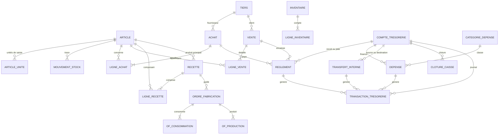

# ERP KEITALA — Dossier de Conception Technique & Architecture

**Version 1.1** — aligné sur `schema.sql` v1.1, le backlog et le dossier UML.

---

## 1. Synthèse des Choix d'Architecture Validés

| Composant | Technologie & Rôle | Hébergement & Déploiement |
| :--- | :--- | :--- |
| **Frontend** | **Next.js (App Router, TypeScript, Tailwind CSS, Lucide Icons, TanStack Query)** | **Vercel** (CDN, SSL automatique, CI/CD sur push Git) |
| **Proxy API** | **Route Handlers Next.js (`/api/*`)** : le navigateur ne parle qu'au domaine du frontend, Next.js relaie vers FastAPI | Vercel (même déploiement que le frontend) |
| **Backend API** | **Python (FastAPI, Pydantic v2, SQLAlchemy 2.0 async, Alembic)** | **VPS Linux** (Docker Compose, Nginx reverse-proxy, SSL Certbot) |
| **Base de Données** | **PostgreSQL 16** | **VPS Linux** (conteneur Docker, volume persistant, sauvegardes quotidiennes) |
| **Trésorerie** | **Caisse Espèces + Compte Bancaire + un compte par opérateur Mobile Money** (Orange Money, Mobicash, Wave) | Saisie **manuelle** des montants, aucune intégration opérateur |
| **Production** | **Deux étapes : Transformation (MP → vrac) puis Conditionnement (vrac + emballages → produit fini)** | Déstockage atomique à la clôture de chaque Ordre de Fabrication |
| **Mode de fonctionnement** | **100 % en ligne** | Pas de mode hors connexion ni de synchronisation différée |

### Décisions de cadrage
* **3 rôles** : `SUPER_ADMIN`, `GESTIONNAIRE`, `CONSULTANT`.
* **Le Super Admin ne valide rien en amont.** Le Gestionnaire valide seul ses opérations ; le Super Admin les contrôle a posteriori (marquage « contrôlé »).
* **Hors périmètre** : le suivi des champs, parcelles et campagnes agricoles. L'ERP démarre à l'entrée en stock (achat ou récolte reçue).
* **Source de vérité du schéma** : `schema.sql` v1.1 sert à créer la base initiale ; toute évolution ultérieure passe par une migration Alembic.

---

## 2. Architecture Globale du Système

```mermaid
flowchart LR
    subgraph Client_Layer [Navigateurs & Tablettes Atelier]
        NAV[Desktop Bureau / Tablette Magasin]
    end

    subgraph Vercel_Platform [Vercel]
        NEXT[Next.js App Router - Pages]
        PROXY[Route Handlers /api/* - Proxy + cookies de session]
        NEXT --> PROXY
    end

    subgraph VPS_Server [Serveur VPS Linux / Docker Compose]
        NGINX[Nginx Reverse Proxy & SSL Let's Encrypt]
        FASTAPI[API FastAPI / Uvicorn]
        PG[(PostgreSQL 16)]
        BACKUP[Cron Sauvegardes Quotidiennes SQL]

        NGINX -->|/api/v1| FASTAPI
        FASTAPI <-->|SQLAlchemy 2.0 Pool| PG
        PG -.-> BACKUP
    end

    NAV -->|HTTPS, même origine| NEXT
    PROXY -->|HTTPS serveur à serveur, Authorization: Bearer| NGINX
```



### Authentification & sécurité via le proxy Next.js
* Le navigateur n'appelle **que** le domaine du frontend (`/api/...`). Il n'y a donc **pas de requête cross-site ni de configuration CORS** côté navigateur.
* Connexion : le Route Handler `/api/auth/login` transmet les identifiants à FastAPI, reçoit le jeton d'accès et le jeton de rafraîchissement (JWT) et les dépose dans des **cookies `HttpOnly`, `Secure`, `SameSite=Lax`** posés sur le domaine du frontend. Le JavaScript de la page n'a jamais accès aux jetons.
* Appels métier : le proxy lit le cookie, ajoute l'en-tête `Authorization: Bearer <jeton>` et relaie la requête à FastAPI. Sur un 401, il tente un rafraîchissement puis rejoue la requête.
* FastAPI n'est appelé que par Vercel (serveur à serveur). L'URL du backend est une variable d'environnement **serveur** (`API_URL`), jamais exposée au navigateur (pas de `NEXT_PUBLIC_`).
* Le contrôle des rôles est fait **dans FastAPI** (dépendances par rôle) ; le masquage des boutons côté frontend n'est qu'un confort d'affichage.

### Intégrité transactionnelle
Chaque opération métier (achat, vente, clôture d'OF, dépense, transfert, inventaire) s'exécute dans **une seule transaction** PostgreSQL :
1. verrouillage des lignes touchées (`SELECT ... FOR UPDATE` sur `articles` et `comptes_tresorerie`) ;
2. écriture de la pièce et de ses lignes ;
3. écriture des mouvements de stock et des écritures de trésorerie ;
4. mise à jour de `stock_actuel`, `cout_moyen` et `solde_actuel`.

La base refuse elle-même un stock négatif (contrainte `chk_stock_non_negatif`), sauf dérogation posée sur l'article par le Super Admin (`autoriser_stock_negatif`).

---

## 3. Modèle de Données (PostgreSQL)

Le détail complet (24 tables, contraintes, index, vues, données initiales) est dans **`schema.sql` v1.1**. Vue d'ensemble :



### Principes structurants

#### 3.1 Articles et unités
* **6 familles** : `SEMENCE`, `INTRANT`, `MATIERE_PREMIERE`, `SEMI_FINI`, `EMBALLAGE`, `PRODUIT_FINI`.
* Chaque article a **une unité de base** (`kg`, `L`, `sachet`, `bouteille`, `unite`). Le stock, le seuil minimum et le PUMP sont toujours exprimés dans cette unité.
* Les autres unités de saisie sont dans `article_unites` (ex. `Sac 50 kg`, facteur 50). Un sac n'est **pas** un article distinct : les doublons Excel `...-KG` / `...-SAC` deviennent un seul article.
* Les lignes d'achat et de vente gardent l'unité saisie, le facteur appliqué et la quantité convertie (`quantite_base`, colonne calculée).

#### 3.2 Journal des stocks
* `mouvements_stock` est **immuable** (déclencheur interdisant UPDATE et DELETE) ; la quantité est signée et `stock_apres = stock_avant + quantite` est vérifié par contrainte.
* Chaque mouvement porte une clé étrangère vers sa pièce d'origine (achat, vente, OF ou inventaire).
* Types : `ENTREE_ACHAT`, `SORTIE_VENTE`, `SORTIE_DON`, `CONSO_PRODUCTION`, `ENTREE_PRODUCTION`, `AJUSTEMENT_INVENTAIRE`, `SORTIE_PERTE`, `ANNULATION`.

#### 3.3 Valorisation (PUMP)
* **Achat** : `nouveau PUMP = (stock × PUMP + quantité achetée × prix) / (stock + quantité achetée)`, en unité de base.
* **Production** : le coût d'un OF est la somme des consommations valorisées au PUMP. Il est réparti sur les produits obtenus au prorata des quantités produites, puis entre dans le PUMP de ces produits. Les pertes sont donc absorbées par le coût de revient.
* **Vente** : le PUMP du moment est copié sur la ligne (`cout_unitaire_base`) pour le rapport de marges.

#### 3.4 Règlements, crédit et Mobile Money
* Il n'y a plus de colonne « mode de règlement » sur la vente ou l'achat. Un **règlement** relie une pièce, un montant et un **compte de trésorerie**.
* Comptes fournis : Caisse, Banque, Orange Money, Mobicash, Wave. Le Super Admin peut en ajouter.
* **Mobile Money** : le Gestionnaire choisit le compte de l'opérateur, saisit le montant à la main et, s'il l'a, le numéro de transaction. Rien n'est automatisé.
* **À crédit** : vente ou achat enregistré sans règlement, ou avec un règlement partiel. Le reste dû se lit dans les vues `v_ventes_soldes`, `v_achats_soldes` et `v_tiers_soldes`. Une vente à crédit exige un client identifié.
* Un règlement ultérieur solde la créance ou la dette. Un paiement mixte (ex. une part en espèces, une part par Wave) donne deux règlements.

#### 3.5 Production en deux étapes
| | Transformation | Conditionnement |
| :--- | :--- | :--- |
| **Entrées** | Matières premières, additifs | Semi-fini en vrac + emballages |
| **Sorties** | Un ou plusieurs semi-finis en vrac (kg) | Un produit fini (sachets, bouteilles) |
| **Exemple** | 64,74 kg de pâte de manioc → 48,26 kg d'attiéké vrac | 48 kg d'attiéké vrac + 96 sachets → 96 sachets de 500 g |

* Un OF peut produire **plusieurs articles** (tapioka petit et gros) et rester **en cours plusieurs jours** : chaque sortie est une ligne datée dans `of_productions`.
* Les consommations **réelles** sont saisies à la clôture (`of_consommations`), pré-remplies d'après la recette.
* Le **reste en vrac** n'est pas une donnée à part : il reste dans le stock du semi-fini. Un semi-fini peut servir de composant à une autre transformation (fonio précuit → djouka).
* Rendement d'une transformation = quantité produite / quantité consommée, calculé à l'affichage.

#### 3.6 Trésorerie
* `transactions_tresorerie` est le journal **immuable** de tous les comptes, avec solde avant et après, relié par clé étrangère au règlement, à la dépense, au transfert ou à la clôture d'origine.
* Un transfert interne génère deux écritures équilibrées (débit du compte source, crédit du compte destination).
* `clotures_caisse` : une clôture par compte et par jour ; solde théorique et écart sont calculés par la base.

#### 3.7 Annulation et contrôle
* Aucune pièce validée n'est supprimée. Une annulation passe la pièce au statut `ANNULE` et contre-passe ses mouvements de stock et ses écritures de trésorerie (type `ANNULATION`).
* Dépenses, transferts, inventaires et clôtures portent `controle_par` / `controle_le` : le Super Admin les marque comme contrôlés après coup, sans bloquer l'opération.

#### 3.8 Numérotation
Format unique `PREFIXE-AAAA-NNNN`, attribué dans la transaction via la table `compteurs_documents` : `FAC` (facture), `DON` (don), `ACH` (achat), `OF` (ordre de fabrication), `INV` (inventaire), `DEP` (dépense), `TRF` (transfert).

---

## 4. Spécification des Endpoints API REST (FastAPI)

Tous les endpoints sont préfixés par `/api/v1`. Toute requête d'écriture venant d'un `CONSULTANT` est rejetée en `403`.

```
/api/v1
│
├── /auth
│   ├── POST /login                    # Authentification, renvoie les JWT au proxy
│   ├── POST /refresh                  # Rafraîchissement du jeton d'accès
│   └── GET  /me                       # Profil utilisateur connecté
│
├── /utilisateurs                      # SUPER_ADMIN uniquement
│   ├── GET    /                       # Liste des comptes
│   ├── POST   /                       # Création d'un compte (3 rôles)
│   └── PUT    /{id}                   # Modification, activation, réinitialisation du mot de passe
│
├── /tiers
│   ├── GET    /                       # Clients et fournisseurs avec créance / dette
│   ├── POST   /                       # Création
│   ├── GET    /{id}                   # Fiche, pièces et règlements
│   └── PUT    /{id}                   # Modification
│
├── /articles
│   ├── GET    /                       # Liste filtrable (famille, seuil bas, recherche)
│   ├── POST   /                       # Création d'article
│   ├── GET    /{id}                   # Fiche article, unités et historique
│   ├── PUT    /{id}                   # Modification (prix, seuils)
│   └── PUT    /{id}/unites            # Unités de saisie et facteurs de conversion
│
├── /stocks
│   ├── GET    /etat-global            # Synthèse valorisée par famille
│   ├── GET    /mouvements             # Journal des mouvements (filtres date, article)
│   ├── GET    /alertes-rupture        # Articles sous le seuil minimum
│   ├── POST   /pertes                 # Sortie pour perte ou avarie hors inventaire
│   ├── GET    /inventaires            # Liste des inventaires
│   ├── POST   /inventaires            # Ouverture d'un inventaire (fige le stock théorique)
│   ├── PUT    /inventaires/{id}       # Saisie des quantités comptées et des motifs
│   └── POST   /inventaires/{id}/valider  # Génère les ajustements de stock
│
├── /achats
│   ├── GET    /                       # Liste des achats avec reste à payer
│   ├── POST   /                       # Création (incrémente le stock, recalcule le PUMP, règlements éventuels)
│   ├── GET    /{id}                   # Détail
│   ├── POST   /{id}/reglements        # Paiement ultérieur d'une dette fournisseur
│   └── POST   /{id}/annuler           # Annulation avec contre-passation
│
├── /ventes
│   ├── GET    /                       # Historique des ventes avec reste à payer
│   ├── POST   /                       # Création (déstocke, règlements éventuels)
│   ├── GET    /{id}                   # Détail
│   ├── GET    /{id}/facture-pdf       # Génération PDF de la facture ou du reçu
│   ├── POST   /{id}/reglements        # Encaissement ultérieur d'une créance
│   ├── POST   /{id}/annuler           # Annulation avec contre-passation
│   └── POST   /dons                   # Sortie don ou échantillon (montant 0, bénéficiaire et motif)
│
├── /production
│   ├── GET    /recettes               # Recettes de transformation et de conditionnement
│   ├── POST   /recettes               # Création d'une recette
│   ├── PUT    /recettes/{id}          # Modification
│   ├── GET    /ordres                 # Liste des OF (filtres type, statut)
│   ├── POST   /ordres                 # Création d'un OF (calcule les besoins prévus)
│   ├── POST   /ordres/{id}/lancer     # Passage en cours (alerte si composants insuffisants)
│   ├── POST   /ordres/{id}/productions  # Déclaration d'une sortie de production datée
│   ├── POST   /ordres/{id}/cloture    # Consommations réelles, pertes, calcul du coût de revient
│   └── POST   /ordres/{id}/annuler    # Annulation
│
├── /tresorerie
│   ├── GET    /comptes                # Comptes et soldes (Caisse, Banque, Mobile Money)
│   ├── POST   /comptes                # Ajout d'un compte (SUPER_ADMIN)
│   ├── GET    /journal                # Journal des écritures par compte
│   ├── POST   /transferts             # Transfert entre deux comptes
│   ├── GET    /depenses               # Historique et filtres
│   ├── POST   /depenses               # Saisie d'une dépense
│   ├── POST   /depenses/{id}/annuler  # Annulation
│   ├── GET    /clotures               # Historique des clôtures
│   └── POST   /clotures               # Clôture journalière d'un compte
│
├── /controles                         # SUPER_ADMIN uniquement
│   ├── GET    /a-controler            # Dépenses, transferts, inventaires, clôtures non contrôlés
│   └── POST   /{type}/{id}            # Marquer une pièce comme contrôlée
│
└── /dashboard
    ├── GET    /kpis                   # CA jour/mois, valeur du stock, soldes, alertes, OF en cours
    └── GET    /marges                 # Marge brute par article
```

---

## 5. Structure & Ergonomie du Frontend (Next.js)

Interface épurée, utilisable au bureau comme sur tablette :

* **/dashboard** : soldes par compte (Caisse, Banque, Mobile Money), alertes de stock bas, CA du jour, OF en cours.
* **/stocks** : onglets par famille :
  * 🌾 *Semences*
  * 🧪 *Intrants*
  * 🌽 *Matières Premières*
  * 🥣 *Semi-finis (vrac)*
  * 📦 *Emballages*
  * 🏷️ *Produits Finis*
  * 🔄 *Journal des Mouvements* et *Inventaires*
* **/production** :
  * Tableau des OF par type (Transformation, Conditionnement) et statut.
  * Déclaration des sorties de production au fil des jours.
  * Formulaire de clôture : consommations réelles pré-remplies, pertes, rendement affiché.
  * Gestionnaire des recettes.
* **/ventes** :
  * Point de vente rapide : client, articles avec recherche instantanée, choix de l'unité (kg ou sac), règlements.
  * Bloc règlement : compte (Caisse, Banque, Orange Money, Mobicash, Wave), montant, référence ; « À crédit » si rien n'est encaissé.
  * Créances clients et encaissements.
  * Registre des dons et échantillons.
* **/achats** :
  * Saisie des réceptions avec choix de l'unité.
  * Dettes fournisseurs et paiements.
* **/tresorerie** :
  * Comptes et journal, graphique des flux.
  * Dépenses avec catégorie obligatoire et confirmation des montants élevés.
  * Transferts et clôture journalière.
* **/administration** (Super Admin) : utilisateurs, comptes de trésorerie, pièces à contrôler.

Les montants sont saisis avec séparateur de milliers ; au-delà d'un seuil paramétrable, une confirmation affiche le montant en toutes lettres (protection contre l'erreur `20 030 000` au lieu de `2 030 000`).

---

## 6. Guide de Déploiement Production (Vercel + VPS)

### A. VPS Linux (Backend & Base de données)
Un fichier `docker-compose.yml` sur le VPS contient :
1. **Conteneur `db`** : image `postgres:16-alpine`, volume persistant `pgdata`, port non exposé sur Internet.
2. **Conteneur `backend`** : image FastAPI (Python 3.11+), port interne `8000`.
3. **Conteneur `nginx`** : reverse proxy, certificat Let's Encrypt, redirige `https://api.<domaine>/api/v1` vers le port 8000.

Initialisation de la base : exécuter `schema.sql` une fois sur la base vide, puis `alembic stamp head` pour que les migrations suivantes partent de cet état.

Sauvegardes : `pg_dump` quotidien par cron, conservé hors du VPS, avec un essai de restauration avant la mise en service.

### B. Vercel (Frontend & Proxy)
1. Dépôt GitHub connecté à Vercel, déploiement automatique à chaque `git push`.
2. Variables d'environnement **serveur** :
   ```env
   API_URL=https://api.<domaine>/api/v1
   ```
3. Aucune URL de backend n'est exposée au navigateur.

### C. Mise en service
1. Créer le compte Super Admin et les comptes utilisateurs.
2. Compléter le catalogue : semi-finis, emballages, matières et additifs absents de l'Excel.
3. Saisir les recettes de transformation et de conditionnement.
4. Faire un **inventaire physique de départ** : les stocks de l'Excel se contredisent d'une feuille à l'autre et ne sont pas repris.
5. Saisir le solde d'ouverture de chaque compte de trésorerie.
