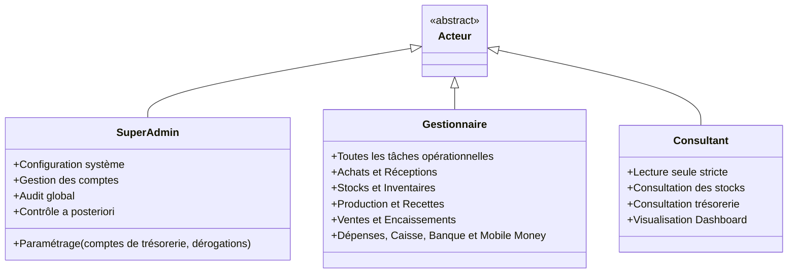

# ERP KEITALA — Dossier de Conception UML

**Version 1.1** — aligné sur `schema.sql` v1.1, le backlog et la conception technique.

Ce document présente la modélisation UML demandée pour l'ERP KEITALA, centrée sur les **3 acteurs définis** et les flux opérationnels de l'entreprise.

---

## 1. Rappel des Acteurs du Système

* **Super Admin** : Responsable / Gérance disposant de l'intégralité des privilèges, de l'administration des utilisateurs, du paramétrage et du **contrôle a posteriori** des opérations. Il ne valide rien en amont : le Gestionnaire n'attend jamais son accord pour travailler.
* **Gestionnaire** : L'acteur central au quotidien qui réalise **toutes les opérations de saisie et de traitement** (stocks, achats, fabrication, vente comptoir, dépenses, transferts).
* **Consultant** : Observateur (associé, auditeur, contrôleur) disposant d'un droit de consultation étendu mais d'**aucune action modificatrice**.

---

## 2. Diagramme des Cas d'Utilisation (Use Case Diagram)

```mermaid
flowchart LR
    %% Acteurs
    Admin["🧑‍💼 Super Admin"]
    Gest["👷 Gestionnaire<br/>(Opérateur principal)"]
    Cons["👁️ Consultant<br/>(Lecteur seul)"]

    subgraph ERP_KEITALA ["Système ERP KEITALA"]
        
        subgraph Securite ["1. Sécurité & Comptes"]
            UC_Auth(["S'authentifier (JWT)"])
            UC_UserMgmt(["Gérer les utilisateurs & rôles"])
            UC_Comptes(["Gérer les comptes de trésorerie & dérogations"])
            UC_Controle(["Contrôler a posteriori (dépenses, transferts, inventaires, clôtures)"])
        end

        subgraph Stocks ["2. Gestion des Stocks Multi-Familles"]
            UC_ArtView(["Consulter l'état des stocks & alertes"])
            UC_ArtCreate(["Créer / Modifier un article (6 familles) et ses unités"])
            UC_Inventaire(["Réaliser un inventaire physique"])
            UC_AuditStock(["Consulter l'historique des mouvements"])
        end

        subgraph Achats ["3. Approvisionnements"]
            UC_AchatCreate(["Enregistrer un achat (MP, semences, intrants, emballages)"])
            UC_AchatView(["Consulter l'historique des achats"])
            UC_Dette(["Payer une dette fournisseur"])
        end

        subgraph Production ["4. Atelier de Transformation"]
            UC_Recette(["Gérer les recettes (transformation & conditionnement)"])
            UC_OF_Launch(["Lancer un OF de transformation ou de conditionnement"])
            UC_OF_Prod(["Déclarer une sortie de production"])
            UC_OF_Close(["Clôturer un OF (consommations réelles, pertes, coût de revient)"])
        end

        subgraph Ventes ["5. Ventes & Facturation"]
            UC_VenteCreate(["Enregistrer une vente (PF, semences, grains)"])
            UC_Reglement(["Régler (Caisse, Banque, Orange Money, Mobicash, Wave) ou laisser à crédit"])
            UC_Facture(["Générer / Imprimer Facture PDF"])
            UC_WhatsApp(["Envoyer la facture via WhatsApp"])
            UC_Dons(["Enregistrer un don / échantillon"])
            UC_Creance(["Encaisser une créance client"])
            UC_Annuler(["Annuler une vente, un achat ou une dépense"])
        end

        subgraph Tresorerie ["6. Trésorerie & Dépenses"]
            UC_SoldeView(["Consulter les soldes (Caisse, Banque, Mobile Money)"])
            UC_Depense(["Saisir une dépense catégorisée"])
            UC_Transfert(["Transférer entre deux comptes"])
            UC_ClotureCaisse(["Effectuer la clôture journalière de caisse"])
        end

        subgraph Reporting ["7. Pilotage & Décision"]
            UC_Dashboard(["Consulter le Tableau de Bord Exécutif"])
            UC_Rapports(["Consulter les rapports de marge"])
        end

    end

    %% Relations Authentification
    Admin --> UC_Auth
    Gest --> UC_Auth
    Cons --> UC_Auth

    Admin --> UC_UserMgmt
    Admin --> UC_Comptes
    Admin --> UC_Controle

    %% Relations Gestionnaire
    Gest --> UC_ArtCreate
    Gest --> UC_Inventaire
    Gest --> UC_AchatCreate
    Gest --> UC_Recette
    Gest --> UC_OF_Launch
    Gest --> UC_OF_Close
    Gest --> UC_VenteCreate
    Gest --> UC_Dons
    Gest --> UC_Depense
    Gest --> UC_Transfert
    Gest --> UC_ClotureCaisse
    Gest --> UC_OF_Prod
    Gest --> UC_Dette
    Gest --> UC_Creance
    Gest --> UC_Annuler

    %% Includes & Extends Ventes
    UC_VenteCreate -.->|<<include>>| UC_Reglement
    UC_VenteCreate -.->|<<include>>| UC_Facture
    UC_Facture -.->|<<extend>> Nice to have| UC_WhatsApp

    %% Relations Consultant (Lecture seule)
    Cons --> UC_ArtView
    Cons --> UC_AuditStock
    Cons --> UC_AchatView
    Cons --> UC_SoldeView
    Cons --> UC_Dashboard
    Cons --> UC_Rapports

    %% Super Admin a aussi les accès de consultation
    Admin --> UC_ArtView
    Admin --> UC_SoldeView
    Admin --> UC_Dashboard
    Admin --> UC_Rapports
    Admin --> UC_AuditStock
    Admin --> UC_AchatView

    %% Le Gestionnaire consulte aussi
    Gest --> UC_ArtView
    Gest --> UC_SoldeView
    Gest --> UC_Dashboard
```

---

## 3. Matrice des Rôles et Cas d'Utilisation

Le Super Admin ne valide aucune opération en amont : il **contrôle après coup**.

| Module | Cas d'Utilisation | Super Admin | Gestionnaire | Consultant |
| :--- | :--- | :---: | :---: | :---: |
| **Sécurité** | S'authentifier | ✅ | ✅ | ✅ |
| | Gérer les utilisateurs et profils | ✅ | ❌ | ❌ |
| | Gérer les comptes de trésorerie et les dérogations | ✅ | ❌ | ❌ |
| | Contrôler a posteriori (dépenses, transferts, inventaires, clôtures) | ✅ | ❌ | ❌ |
| **Stocks** | Consulter les stocks & alertes | ✅ | ✅ | ✅ *(Lecture)* |
| | Créer / Modifier articles et unités | ✅ | ✅ | ❌ |
| | Réaliser et valider un inventaire | ❌ *(Contrôle)* | ✅ | ❌ |
| | Enregistrer une perte ou une avarie | ❌ | ✅ | ❌ |
| | Consulter le journal des mouvements | ✅ | ✅ | ✅ *(Lecture)* |
| **Achats** | Enregistrer un achat | ❌ | ✅ | ❌ |
| | Payer une dette fournisseur | ❌ | ✅ | ❌ |
| | Consulter l'historique des achats | ✅ | ✅ | ✅ *(Lecture)* |
| **Production** | Gérer les recettes (transformation, conditionnement) | ✅ | ✅ | ❌ |
| | Lancer un Ordre de Fabrication (OF) | ❌ | ✅ | ❌ |
| | Déclarer une sortie de production | ❌ | ✅ | ❌ |
| | Clôturer un OF | ❌ | ✅ | ❌ |
| **Ventes** | Enregistrer une vente & ses règlements | ❌ | ✅ | ❌ |
| | Encaisser une créance client | ❌ | ✅ | ❌ |
| | Générer / Imprimer facture PDF | ✅ | ✅ | ✅ *(Lecture)* |
| | Envoyer facture via WhatsApp *(Nice to have)* | ✅ | ✅ | ❌ |
| | Enregistrer un don / échantillon | ❌ | ✅ | ❌ |
| **Annulations** | Annuler une vente, un achat ou une dépense | ❌ | ✅ | ❌ |
| **Trésorerie** | Consulter soldes et journaux des comptes | ✅ | ✅ | ✅ *(Lecture)* |
| | Saisir une dépense d'exploitation | ❌ | ✅ | ❌ |
| | Transférer entre deux comptes | ❌ *(Contrôle)* | ✅ | ❌ |
| | Clôture de caisse (billetage) | ❌ *(Contrôle)* | ✅ | ❌ |
| **Pilotage** | Dashboard exécutif & KPIs | ✅ | ✅ | ✅ *(Lecture)* |
| | Rapports de marges par produit | ✅ | ✅ | ✅ *(Lecture)* |

---

## 4. Diagramme de Classes (Class Diagram)

```mermaid
classDiagram
    direction TB

    %% ENUMS
    class RoleUtilisateurEnum {
        <<enumeration>>
        SUPER_ADMIN
        GESTIONNAIRE
        CONSULTANT
    }

    class FamilleArticleEnum {
        <<enumeration>>
        SEMENCE
        INTRANT
        MATIERE_PREMIERE
        SEMI_FINI
        EMBALLAGE
        PRODUIT_FINI
    }

    class TypeMouvementStockEnum {
        <<enumeration>>
        ENTREE_ACHAT
        SORTIE_VENTE
        SORTIE_DON
        CONSO_PRODUCTION
        ENTREE_PRODUCTION
        AJUSTEMENT_INVENTAIRE
        SORTIE_PERTE
        ANNULATION
    }

    class StatutDocumentEnum {
        <<enumeration>>
        VALIDE
        ANNULE
    }

    class TypeOFEnum {
        <<enumeration>>
        TRANSFORMATION
        CONDITIONNEMENT
    }

    class StatutOFEnum {
        <<enumeration>>
        BROUILLON
        EN_COURS
        TERMINE
        ANNULE
    }

    class TypeCompteTresorerieEnum {
        <<enumeration>>
        CAISSE
        BANQUE
        MOBILE_MONEY
    }

    class TypeFluxTresorerieEnum {
        <<enumeration>>
        SOLDE_INITIAL
        ENCAISSEMENT_VENTE
        DECAISSEMENT_ACHAT
        DEPENSE_EXPLOITATION
        TRANSFERT_INTERNE
        ECART_CLOTURE
        ANNULATION
    }

    %% CLASSES METIER
    class Utilisateur {
        +UUID id
        +String nom_complet
        +String email
        +String mot_de_passe_hash
        +RoleUtilisateurEnum role
        +Boolean est_actif
        +seConnecter(email, password) Boolean
        +changerMotDePasse(nouveau) void
    }

    class Tiers {
        +UUID id
        +String code_tiers
        +String nom
        +String telephone
        +String adresse
        +Boolean est_client
        +Boolean est_fournisseur
        +soldeCreance() Decimal
        +soldeDette() Decimal
    }

    class Article {
        +UUID id
        +String code_sku
        +String designation
        +FamilleArticleEnum famille
        +String categorie_code
        +String contenance
        +String unite_base
        +Decimal stock_actuel
        +Decimal stock_minimum
        +Decimal cout_moyen
        +Decimal prix_vente_standard
        +Boolean autoriser_stock_negatif
        +Boolean est_actif
        +verifierDisponibilite(qteBase) Boolean
        +mouvementer(qteBase, type, piece) void
        +estEnAlerteRupture() Boolean
        +recalculerPUMP(qteBase, coutUnitaire) void
    }

    class ArticleUnite {
        +Long id
        +UUID article_id
        +String libelle
        +Decimal facteur_vers_base
        +convertirEnBase(qte) Decimal
    }

    class MouvementStock {
        +Long id
        +UUID article_id
        +TypeMouvementStockEnum type_mouvement
        +Decimal quantite
        +Decimal cout_unitaire
        +Decimal stock_avant
        +Decimal stock_apres
        +UUID achat_id
        +UUID vente_id
        +UUID ordre_fabrication_id
        +UUID inventaire_id
        +String motif
        +DateTime date_mouvement
    }

    class Achat {
        +UUID id
        +String numero
        +String numero_facture_fournisseur
        +UUID fournisseur_id
        +String fournisseur_nom_libre
        +Date date_achat
        +Decimal montant_total
        +StatutDocumentEnum statut
        +valider() void
        +annuler(motif) void
        +resteAPayer() Decimal
    }

    class LigneAchat {
        +Long id
        +UUID article_id
        +Long unite_id
        +Decimal facteur_conversion
        +Decimal quantite
        +Decimal prix_unitaire
        +Decimal quantite_base
        +Decimal montant_total
    }

    class Vente {
        +UUID id
        +String numero_facture
        +UUID client_id
        +String client_nom_libre
        +Date date_vente
        +Decimal montant_total
        +Boolean est_don
        +String beneficiaire_don
        +String motif_don
        +StatutDocumentEnum statut
        +valider() void
        +annuler(motif) void
        +resteAPayer() Decimal
        +genererFacturePDF() Byte[]
        +genererLienWhatsApp() String
    }

    class LigneVente {
        +Long id
        +UUID article_id
        +Long unite_id
        +Decimal facteur_conversion
        +Decimal quantite
        +Decimal prix_unitaire
        +Decimal cout_unitaire_base
        +Decimal quantite_base
        +Decimal montant_total
    }

    class Reglement {
        +UUID id
        +UUID vente_id
        +UUID achat_id
        +Int compte_id
        +Decimal montant
        +Date date_reglement
        +String reference_paiement
        +StatutDocumentEnum statut
        +enregistrer() void
        +annuler() void
    }

    class Recette {
        +UUID id
        +TypeOFEnum type_of
        +UUID article_produit_id
        +String nom_recette
        +Decimal quantite_base_produite
        +Boolean est_active
        +calculerBesoins(qtePrevue) List
    }

    class LigneRecette {
        +Long id
        +UUID article_composant_id
        +Decimal quantite_necessaire
    }

    class OrdreFabrication {
        +UUID id
        +String numero_of
        +TypeOFEnum type_of
        +UUID recette_id
        +Decimal quantite_prevue
        +Decimal quantite_pertes
        +StatutOFEnum statut
        +DateTime date_lancement
        +DateTime date_cloture
        +lancer() void
        +declarerProduction(article, qte, date) void
        +cloturer(consommationsReelles, pertes) void
        +annuler() void
        +rendement() Decimal
    }

    class OFConsommation {
        +Long id
        +UUID article_composant_id
        +Decimal quantite_prevue
        +Decimal quantite_consommee
        +Decimal cout_unitaire
    }

    class OFProduction {
        +Long id
        +UUID article_produit_id
        +Date date_production
        +Decimal quantite_produite
        +Decimal cout_unitaire
    }

    class Inventaire {
        +UUID id
        +String numero
        +Date date_inventaire
        +String statut
        +DateTime valide_le
        +UUID controle_par
        +valider() void
    }

    class LigneInventaire {
        +Long id
        +UUID article_id
        +Decimal stock_theorique
        +Decimal stock_physique
        +Decimal ecart
        +String motif
    }

    class CompteTresorerie {
        +Int id
        +String code
        +String nom
        +TypeCompteTresorerieEnum type
        +String operateur
        +Decimal solde_actuel
        +crediter(montant, piece) void
        +debiter(montant, piece) void
    }

    class CategorieDepense {
        +Int id
        +String nom
        +String description
    }

    class Depense {
        +UUID id
        +String numero
        +Int categorie_id
        +Int compte_id
        +Date date_depense
        +String designation
        +Decimal montant
        +StatutDocumentEnum statut
        +UUID controle_par
        +enregistrer() void
        +annuler(motif) void
    }

    class TransfertInterne {
        +UUID id
        +String numero
        +Int compte_source_id
        +Int compte_destination_id
        +Decimal montant
        +Date date_transfert
        +UUID controle_par
        +executer() void
    }

    class ClotureCaisse {
        +UUID id
        +Int compte_id
        +Date date_cloture
        +Decimal solde_ouverture
        +Decimal total_entrees
        +Decimal total_sorties
        +Decimal solde_theorique
        +Decimal solde_physique
        +Decimal ecart
        +UUID controle_par
    }

    class TransactionTresorerie {
        +Long id
        +Int compte_id
        +TypeFluxTresorerieEnum type_flux
        +String sens
        +Decimal montant
        +Decimal solde_avant
        +Decimal solde_apres
        +String libelle
        +UUID reglement_id
        +UUID depense_id
        +UUID transfert_id
        +UUID cloture_id
        +DateTime date_transaction
    }

    %% RELATIONS
    Utilisateur "1" -- "0..*" MouvementStock : enregistre
    Utilisateur "1" -- "0..*" OrdreFabrication : supervise
    Utilisateur "1" -- "0..*" Vente : saisit
    Utilisateur "1" -- "0..*" Achat : saisit
    Utilisateur "1" -- "0..*" Depense : engage

    Article "1" *-- "0..*" ArticleUnite : unites de saisie
    Article "1" -- "0..*" MouvementStock : trace

    Tiers "0..1" -- "0..*" Achat : livre
    Tiers "0..1" -- "0..*" Vente : achete

    Achat "1" *-- "1..*" LigneAchat : compose
    LigneAchat "0..*" -- "1" Article : concerne
    Vente "1" *-- "1..*" LigneVente : compose
    LigneVente "0..*" -- "1" Article : concerne

    Vente "1" -- "0..*" Reglement : encaissee par
    Achat "1" -- "0..*" Reglement : paye par
    Reglement "0..*" -- "1" CompteTresorerie : sur

    Article "1" -- "0..*" Recette : produit principal
    Recette "1" *-- "1..*" LigneRecette : contient
    LigneRecette "0..*" -- "1" Article : composant
    Recette "1" -- "0..*" OrdreFabrication : guide
    OrdreFabrication "1" *-- "1..*" OFConsommation : consomme
    OrdreFabrication "1" *-- "1..*" OFProduction : produit
    OFConsommation "0..*" -- "1" Article : composant
    OFProduction "0..*" -- "1" Article : produit obtenu

    Inventaire "1" *-- "1..*" LigneInventaire : compte
    LigneInventaire "0..*" -- "1" Article : concerne

    CompteTresorerie "1" -- "0..*" TransactionTresorerie : journal
    CompteTresorerie "1" -- "0..*" Depense : finance
    CompteTresorerie "1" -- "0..*" ClotureCaisse : cloture
    CompteTresorerie "1" -- "0..*" TransfertInterne : source ou destination
    CategorieDepense "1" -- "0..*" Depense : classe

    Reglement ..> TransactionTresorerie : genere
    Depense ..> TransactionTresorerie : genere
    TransfertInterne ..> TransactionTresorerie : genere deux ecritures
    ClotureCaisse ..> TransactionTresorerie : regularise l ecart
```

---

## 5. Description Détaillée des Relations & Comportements Métier

### 5.1 Articles, unités et mouvements de stock
* Un `Article` a une **unité de base** ; son stock, son seuil et son coût moyen sont tenus dans cette unité. Les `ArticleUnite` ajoutent des unités de saisie (ex. `Sac 50 kg`, facteur 50). Un sac n'est pas un article distinct.
* Tout mouvement physique crée un enregistrement **immuable** dans `MouvementStock`, relié à sa pièce d'origine. La quantité est signée (positive en entrée, négative en sortie).
* Types de mouvements :
  * `ENTREE_ACHAT` : lié à un `Achat` validé.
  * `SORTIE_VENTE` : lié à une `Vente` validée.
  * `SORTIE_DON` : lié à une `Vente` marquée don ou échantillon.
  * `CONSO_PRODUCTION` : consommation des composants à la clôture d'un `OrdreFabrication`.
  * `ENTREE_PRODUCTION` : entrée des produits obtenus par l'OF.
  * `AJUSTEMENT_INVENTAIRE` : écart constaté par un `Inventaire` validé.
  * `SORTIE_PERTE` : casse ou avarie hors inventaire, motif obligatoire.
  * `ANNULATION` : contre-passation d'un mouvement d'une pièce annulée.
* Une sortie qui rendrait le stock négatif est refusée, sauf dérogation posée sur l'article (`autoriser_stock_negatif`).

### 5.2 Production en deux étapes
* Une `Recette` est de type `TRANSFORMATION` (matières et additifs → semi-fini en vrac) ou `CONDITIONNEMENT` (semi-fini + emballage → produit fini). La nature d'un composant se lit sur la famille de son article.
* Un `OrdreFabrication` suit une recette :
  1. `lancer()` calcule les besoins prévus (`OFConsommation.quantite_prevue`) et alerte si un composant manque.
  2. `declarerProduction()` ajoute une ligne datée dans `OFProduction`. Un OF de transformation peut produire plusieurs articles (tapioka petit et gros) et durer plusieurs jours.
  3. `cloturer()` enregistre les consommations réelles et les pertes, déstocke les composants, entre les produits en stock et calcule leur coût de revient : coût total des consommations (au PUMP) réparti au prorata des quantités produites.
* Le reste en vrac après ensachage n'est pas une donnée à part : il demeure dans le stock du semi-fini.
* Un semi-fini peut être le composant d'une autre transformation (fonio précuit → djouka).

### 5.3 Ventes, règlements, crédit et Mobile Money
* Une `Vente` comporte des `LigneVente` sur des articles de toute famille vendable (produits finis, semences, grains bruts). Chaque ligne garde l'unité saisie, la quantité convertie et le coût moyen du moment (pour la marge).
* Le paiement n'est pas un attribut de la vente : c'est un ou plusieurs `Reglement`, chacun sur un `CompteTresorerie`.
  * Compte **Caisse** : espèces.
  * Compte **Banque** : virement, chèque, versement.
  * Comptes **Mobile Money** : Orange Money, Mobicash, Wave. Saisie **manuelle** : le Gestionnaire choisit le compte de l'opérateur, tape le montant et, s'il l'a, le numéro de transaction.
  * **À crédit** : aucun règlement ou règlement partiel. La vente exige alors un client identifié ; `resteAPayer()` et `Tiers.soldeCreance()` donnent la créance. Un `Reglement` ultérieur la solde.
* Les achats suivent la même logique côté fournisseur (`Tiers.soldeDette()`).
* Chaque `Reglement` génère une `TransactionTresorerie` et met à jour le solde du compte.
* **Option WhatsApp** : `genererLienWhatsApp()` construit un lien `https://wa.me/<tel>?text=...` avec le numéro de facture, les articles, le montant total et le lien du reçu.

### 5.4 Trésorerie
* `TransactionTresorerie` est le journal immuable de tous les comptes, avec solde avant et après.
* Un `TransfertInterne` génère deux écritures équilibrées (débit du compte source, crédit du compte destination).
* Une `ClotureCaisse` compare le solde théorique du jour au solde compté ; l'écart éventuel est régularisé par une écriture `ECART_CLOTURE`.

### 5.5 Annulation et contrôle a posteriori
* Une vente, un achat, un règlement ou une dépense validés ne sont jamais supprimés : `annuler()` passe la pièce à `ANNULE` et contre-passe ses mouvements de stock et ses écritures de trésorerie.
* Le Gestionnaire valide seul ses opérations. Le Super Admin marque ensuite dépenses, transferts, inventaires et clôtures comme contrôlés (`controle_par`, `controle_le`). Ce contrôle ne bloque rien.
