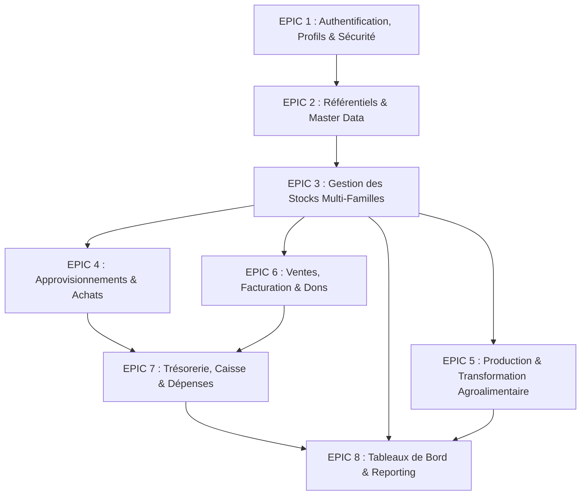

# ERP KEITALA — Product Backlog Complet

**Version 1.1** — aligné sur `schema.sql` v1.1, le dossier UML et la conception technique.

---

## 1. Définition des Rôles & Acteurs du Système

Le système est configuré autour de **3 profils utilisateurs exclusifs** :

| Rôle | Description & Périmètre de Responsabilité | Droits d'Accès |
| :--- | :--- | :--- |
| **Super Admin** | Propriétaire / Directrice de l'entreprise ou Responsable IT. | **Administration et contrôle** : gestion des comptes utilisateurs, paramétrage (comptes de trésorerie, dérogation de stock négatif), articles et recettes, consultation complète, **contrôle a posteriori** des opérations. Il ne valide rien en amont. |
| **Gestionnaire** | Opérateur principal de l'application au quotidien ("la personne qui fait toutes les tâches"). | **Lecture / Écriture / Exécution** : achats, stocks, recettes et ordres de fabrication, ventes, encaissements, dépenses, transferts, inventaires, clôtures. Il valide seul ses opérations. |
| **Consultant** | Observateur, auditeur ou associé ("1 pour consulter"). | **Lecture seule stricte** : tableaux de bord, niveaux de stocks, historique des ventes, achats et trésorerie. Aucun droit d'ajout, de modification ou d'annulation. |

**Cadrage** : application 100 % en ligne ; le suivi des champs et des parcelles est hors périmètre (l'ERP commence à l'entrée en stock).

---

## 2. Vue d'Ensemble des Épics

---

## 3. Détail des User Stories par Épic

---

### EPIC 1 : Authentification, Profils & Sécurité

#### US-AUTH-01 : Connexion sécurisée
* **En tant que** : Tout utilisateur (Super Admin, Gestionnaire, Consultant)
* **Je veux** : M'authentifier avec mon email et mot de passe sécurisé
* **Afin de** : Accéder à mon espace de travail selon mes permissions
* **Critères d'acceptation** :
  * Écran de connexion épuré avec messages d'erreurs clairs en cas d'identifiants incorrects.
  * Jetons JWT (accès + rafraîchissement) à expiration configurable, conservés dans des cookies `HttpOnly` posés par le proxy Next.js ; le navigateur n'appelle jamais le backend directement.
  * Redirection automatique vers le Dashboard adapté au profil.
* **Priorité** : **Must Have**

#### US-AUTH-02 : Gestion des comptes utilisateurs
* **En tant que** : Super Admin
* **Je veux** : Créer, activer, désactiver ou modifier les comptes utilisateurs et leur attribuer l'un des 3 rôles
* **Afin de** : Contrôler rigoureusement qui accède aux données de l'entreprise
* **Critères d'acceptation** :
  * Liste des utilisateurs avec statut (Actif/Inactif) et rôle affiché.
  * Impossible de créer un rôle autre que les 3 rôles définis.
  * Réinitialisation de mot de passe disponible pour l'Admin.
* **Priorité** : **Must Have**

#### US-AUTH-03 : Cloisonnement strict des droits (RBAC)
* **En tant que** : Consultant
* **Je veux** : Consulter tous les écrans sans voir les boutons d'action (Ajouter, Modifier, Supprimer, Valider)
* **Afin de** : Préserver l'intégrité absolue des données contre toute fausse manipulation
* **Critères d'acceptation** :
  * Masquage visuel des boutons d'action pour le Consultant.
  * Sécurité au niveau de l'API Backend (FastAPI rejette en code 403 toute requête POST/PUT/DELETE venant d'un Consultant).
* **Priorité** : **Must Have**

---

### EPIC 2 : Référentiels & Master Data

#### US-REF-01 : Gestion du répertoire des Tiers (Clients & Fournisseurs)
* **En tant que** : Gestionnaire
* **Je veux** : Enregistrer et mettre à jour les coordonnées des clients et des fournisseurs (Nom, Téléphone, Adresse)
* **Afin de** : Éviter les doublons et normaliser les informations de facturation
* **Critères d'acceptation** :
  * Fiche tiers avec case à cocher "Client" et/ou "Fournisseur".
  * Affichage du solde en cours (créance due par le client ou dette due au fournisseur).
* **Priorité** : **Must Have**

#### US-REF-02 : Unités de saisie et conversions automatiques
* **En tant que** : Gestionnaire ou Super Admin
* **Je veux** : Définir pour chaque article son unité de base et ses unités de saisie avec leur facteur de conversion (ex : 1 Sac = 50 kg)
* **Afin de** : Manipuler des sacs ou des kilogrammes sans fausser les stocks
* **Critères d'acceptation** :
  * Un article a une seule unité de base (kg, L, sachet, bouteille, unité) ; stock, seuil et coût sont tenus dans cette unité.
  * Unités de saisie paramétrables par article : `Sac 50 kg = 50 kg`. Un sac n'est pas un article distinct.
  * Choix de l'unité sur chaque ligne d'achat et de vente ; la quantité convertie en unité de base est affichée.
* **Priorité** : **Must Have**

#### US-REF-03 : Comptes de trésorerie
* **En tant que** : Super Admin
* **Je veux** : Gérer la liste des comptes de trésorerie (Caisse, Banque, comptes Mobile Money)
* **Afin que** : Chaque encaissement et chaque paiement soit rattaché au bon compte
* **Critères d'acceptation** :
  * Comptes fournis au départ : Caisse Principale, Compte Bancaire, Orange Money, Mobicash, Wave.
  * Ajout ou désactivation d'un compte ; un compte Mobile Money porte le nom de son opérateur.
  * Saisie du solde d'ouverture de chaque compte à la mise en service.
* **Priorité** : **Must Have**

---

### EPIC 3 : Gestion Complète des Stocks Multi-Familles

#### US-STK-01 : Catalogue des articles classés par famille
* **En tant que** : Gestionnaire
* **Je veux** : Créer et classifier les articles selon les 6 familles prédéfinies :
  1. *Semences Agricoles* (Soja semence)
  2. *Intrants Agricoles & Traitement* (engrais, produits phyto, sacs de stockage)
  3. *Matières Premières* (Soja grain, Maïs, Mil, Fonio brut, Pâte de manioc, Arachide, additifs)
  4. *Semi-finis en vrac* (Attiéké vrac, Tapioka vrac, Fonio précuit, Djouka vrac)
  5. *Emballages & Conditionnement* (sachets 200g, 400g, 500g, 1kg, bouteilles, étiquettes)
  6. *Produits Finis* (Café de soja, Soumbala, Gari, Attiéké, Tapioka...)
* **Afin de** : Disposer d'une vision nette et organisée de l'ensemble du patrimoine physique
* **Critères d'acceptation** :
  * Chaque article a un code SKU unique (ex: `KN-SOJ-CAF200`) et une unité de base.
  * Prix de vente standard saisi ; coût moyen (PUMP) calculé par le système, non saisi.
  * Définition d'un seuil de stock minimum d'alerte, en unité de base.
* **Priorité** : **Must Have**

#### US-STK-02 : Consultation filtrée des stocks & valorisation
* **En tant que** : Gestionnaire ou Consultant
* **Je veux** : Visualiser l'état des stocks en temps réel avec filtres par famille et recherche textuelle
* **Afin de** : Connaître les quantités disponibles et la valeur financière totale du stock
* **Critères d'acceptation** :
  * Onglets par famille d'articles.
  * Affichage de : Quantité en stock, Unité, Valeur unitaire PUMP, Valeur totale du stock.
  * Indicateur visuel couleur (Vert = OK, Rouge = Stock bas sous le minimum).
* **Priorité** : **Must Have**

#### US-STK-03 : Alertes automatiques de réapprovisionnement
* **En tant que** : Gestionnaire ou Consultant
* **Je veux** : Être alerté dès qu'un article franchit son seuil minimum
* **Afin de** : Déclencher les approvisionnements à temps et éviter toute rupture
* **Critères d'acceptation** :
  * Badge d'alerte sur le Dashboard principal avec le nombre d'articles en alerte.
  * Page dédiée listant les articles critiques à réapprovisionner.
* **Priorité** : **Must Have**

#### US-STK-04 : Inventaire physique & Régularisation des écarts
* **En tant que** : Gestionnaire
* **Je veux** : Saisir les quantités physiques réelles constatées lors d'un comptage et valider les ajustements
* **Afin de** : Aligner le stock informatique sur la réalité physique (avaries, pertes au séchage)
* **Critères d'acceptation** :
  * Ouverture d'un inventaire (`INV-2026-XXXX`), toutes familles ou une seule ; le stock théorique est figé à l'ouverture.
  * Saisie de la quantité réelle et calcul automatique de l'écart.
  * Motif obligatoire pour tout écart (Casse, Avarie, Dessiccation, Erreur de comptage, Autre).
  * La validation par le Gestionnaire génère les lignes d'ajustement dans le journal des mouvements.
  * L'inventaire validé apparaît dans la liste « à contrôler » du Super Admin (contrôle a posteriori, non bloquant).
  * L'inventaire sert aussi à saisir le **stock de départ** à la mise en service.
* **Priorité** : **Must Have**

#### US-STK-06 : Sortie pour perte ou avarie
* **En tant que** : Gestionnaire
* **Je veux** : Sortir du stock une quantité perdue, cassée ou avariée en dehors d'un inventaire
* **Afin de** : Garder un stock juste sans attendre le prochain comptage
* **Critères d'acceptation** :
  * Choix de l'article, quantité, motif obligatoire.
  * Mouvement de type perte dans le journal, sans impact financier de trésorerie.
* **Priorité** : **Should Have**

#### US-STK-05 : Journal d'audit des mouvements de stock
* **En tant que** : Consultant ou Super Admin
* **Je veux** : Consulter l'historique chronologique complet de chaque mouvement de stock
* **Afin de** : Tracer l'origine exacte de toute entrée ou sortie
* **Critères d'acceptation** :
  * Colonnes : Date/Heure, Article, Type (Entrée achat, Sortie vente, Conso OF, Entrée OF, Ajustement), Quantité, Stock Avant, Stock Après, Pièce de référence, Auteur.
  * Filtre par date et par article.
* **Priorité** : **Must Have**

---

### EPIC 4 : Approvisionnements & Achats

#### US-ACH-01 : Enregistrement d'un achat avec imputation automatique
* **En tant que** : Gestionnaire
* **Je veux** : Enregistrer une réception d'achats (Matières premières, semences, intrants ou emballages)
* **Afin que** : Le stock soit incrémenté immédiatement et le paiement imputé sur le bon compte
* **Critères d'acceptation** :
  * Numéro interne automatique (`ACH-2026-XXXX`) ; référence de la facture du fournisseur en option.
  * Sélection du fournisseur (ou saisie libre).
  * Ajout multi-articles avec unité (kg ou sac), quantité et prix d'achat unitaire.
  * Règlement : un ou plusieurs paiements, chacun sur un compte :
    * **Caisse** (espèces)
    * **Banque**
    * **Orange Money, Mobicash ou Wave** : montant saisi à la main, numéro de transaction en option. Rien n'est automatique.
    * **À crédit** : aucun paiement ou paiement partiel ; le reste devient une dette fournisseur (fournisseur identifié obligatoire).
  * Incrémentation atomique du stock des articles achetés, en unité de base.
  * Recalcul automatique du PUMP de chaque article.
* **Priorité** : **Must Have**

#### US-ACH-02 : Historique des achats & Factures fournisseurs
* **En tant que** : Gestionnaire ou Consultant
* **Je veux** : Consulter la liste de tous les achats passés avec filtre par fournisseur et période
* **Afin de** : Vérifier les dépenses d'approvisionnement et justifier les pièces comptables
* **Critères d'acceptation** :
  * Liste détaillée avec N° de facture/bordereau, date, montant, mode de règlement.
  * Fiche détail visualisable pour chaque achat.
* **Priorité** : **Must Have**

#### US-ACH-03 : Paiement d'une dette fournisseur
* **En tant que** : Gestionnaire
* **Je veux** : Enregistrer un paiement sur un achat à crédit
* **Afin de** : Solder progressivement les dettes fournisseurs
* **Critères d'acceptation** :
  * Liste des achats non soldés avec le reste à payer.
  * Saisie du montant, du compte payeur et de la référence ; le montant ne peut pas dépasser le reste à payer.
  * Débit du compte et mise à jour de la dette du fournisseur.
* **Priorité** : **Must Have**

#### US-ACH-04 : Annulation d'un achat
* **En tant que** : Gestionnaire
* **Je veux** : Annuler un achat saisi par erreur, avec un motif
* **Afin de** : Corriger sans supprimer de pièce
* **Critères d'acceptation** :
  * L'achat passe au statut « Annulé » et reste visible dans l'historique.
  * Le stock est repris et les paiements sont contre-passés sur leurs comptes.
  * Refus si le stock reçu a déjà été consommé ou vendu au point de devenir négatif.
* **Priorité** : **Should Have**

---

### EPIC 5 : Production & Transformation Agroalimentaire

La production se fait en **deux étapes** : la **transformation** (matières premières → semi-fini en vrac) puis le **conditionnement** (semi-fini en vrac + emballages → produit fini).

#### US-PROD-01 : Fiches Recettes de transformation et de conditionnement
* **En tant que** : Gestionnaire
* **Je veux** : Créer et modifier les recettes des deux étapes
* **Afin de** : Standardiser le processus de production
* **Critères d'acceptation** :
  * Recette de **transformation** : semi-fini cible et matières nécessaires pour une quantité de vrac (ex: *Djouka vrac* = Fonio + Arachide + Bicarbonate + Potasse).
  * Recette de **conditionnement** : produit fini cible, quantité de vrac et emballage par unité (ex: *Attiéké 500 g* = 0,5 kg d'attiéké vrac + 1 sachet 500 g).
  * Un semi-fini peut être le composant d'une autre transformation (Fonio précuit → Djouka).
* **Priorité** : **Must Have**

#### US-PROD-02 : Création & Lancement d'un Ordre de Fabrication (OF)
* **En tant que** : Gestionnaire
* **Je veux** : Lancer un OF de transformation ou de conditionnement en précisant la recette et la quantité visée
* **Afin de** : Planifier le travail de l'atelier et vérifier la disponibilité des composants
* **Critères d'acceptation** :
  * Attribution d'un numéro unique automatique (`OF-2026-XXXX`).
  * Calcul prévisionnel des besoins en matières, en vrac et en emballages.
  * Message d'alerte si le stock d'un composant est insuffisant.
* **Priorité** : **Must Have**

#### US-PROD-03 : Déclaration des sorties de production
* **En tant que** : Gestionnaire
* **Je veux** : Déclarer ce qui sort de l'atelier au fil des jours, tant que l'OF est en cours
* **Afin de** : Suivre un lot traité sur plusieurs jours ou donnant plusieurs produits
* **Critères d'acceptation** :
  * Une ou plusieurs sorties par OF, chacune avec sa date, son article et sa quantité.
  * Un OF de transformation peut produire plusieurs articles (ex: Tapioka petit et Tapioka gros à partir du même lot de pâte de manioc).
* **Priorité** : **Must Have**

#### US-PROD-04 : Clôture d'OF avec déstockage automatique
* **En tant que** : Gestionnaire
* **Je veux** : Clôturer un OF en confirmant les consommations réelles et les pertes
* **Afin que** : Le système déstocke les composants, entre les produits en stock et calcule leur coût
* **Critères d'acceptation** :
  * Consommations réelles pré-remplies d'après la recette et modifiables.
  * Saisie des pertes (déchets, triage).
  * **Transformation** : déstockage des matières, entrée du ou des semi-finis en vrac, rendement affiché (quantité produite / quantité consommée).
  * **Conditionnement** : déstockage du vrac **et** des emballages, entrée du produit fini. Le vrac non ensaché reste dans le stock du semi-fini.
  * Coût de revient calculé : coût des consommations (au PUMP) réparti sur les quantités produites.
  * Clôture refusée si un composant manque ; statut de l'OF passant à `TERMINE`.
* **Priorité** : **Must Have**

---

### EPIC 6 : Ventes, Facturation & Sorties Non Commerciales

#### US-VTE-01 : Saisie rapide de vente (Comptoir & Gros)
* **En tant que** : Gestionnaire
* **Je veux** : Enregistrer une vente en quelques clics en sélectionnant les articles et les quantités
* **Afin de** : Servir le client rapidement, déstocker l'article et encaisser le montant
* **Critères d'acceptation** :
  * Possibilité de vendre des **Produits Finis**, mais aussi des **Semences** ou des **Grains bruts**.
  * Recherche instantanée d'articles avec prix unitaire pré-rempli (modifiable) et choix de l'unité (kg ou sac).
  * Sélection du client ou "Client comptoir / de passage".
  * Déstockage immédiat des articles vendus, en unité de base.
  * Blocage si stock insuffisant (avec alerte explicite).
* **Priorité** : **Must Have**

#### US-VTE-02 : Règlements & Encaissement automatique
* **En tant que** : Gestionnaire
* **Je veux** : Enregistrer le ou les règlements d'une vente en choisissant le compte qui reçoit l'argent
* **Afin que** : Le paiement exact soit tracé et la trésorerie actualisée
* **Critères d'acceptation** :
  * **Caisse** → crédit immédiat de la Caisse Principale.
  * **Banque** → crédit immédiat du Compte Bancaire.
  * **Mobile Money** → choix du compte de l'opérateur (**Orange Money, Mobicash ou Wave**), montant saisi à la main, numéro de transaction en option ; crédit du compte de cet opérateur. Aucune connexion automatique à l'opérateur.
  * **À crédit** → aucun règlement ou règlement partiel ; le reste dû devient une créance sur la fiche du client. Client identifié obligatoire.
  * Paiement mixte possible (ex: une part en espèces, une part par Wave) ; le total réglé ne peut pas dépasser le montant de la vente.
* **Priorité** : **Must Have**

#### US-VTE-03 : Génération, Impression et Envoi de Facture / Reçu
* **En tant que** : Gestionnaire ou Consultant
* **Je veux** : Générer une facture proforma ou définitive, l'imprimer en PDF et pouvoir l'envoyer au client
* **Afin de** : La remettre au client en main propre ou par voie électronique
* **Critères d'acceptation** :
  * N° unique incrémental (`FAC-2026-XXXX`).
  * Détail des lignes, sous-total, règlements reçus (compte et opérateur Mobile Money le cas échéant) et solde restant.
  * Bouton "Télécharger PDF" ou "Imprimer".
  * **Option Nice to Have (Could Have)** : Bouton "Envoyer par WhatsApp" générant automatiquement un lien direct (`https://wa.me/<tel>?text=...`) pré-rempli avec le résumé de la facture et le lien d'accès/téléchargement du reçu pour transmission immédiate sur le téléphone du client.
* **Priorité** : **Must Have** (avec composante WhatsApp en **Could Have**)

#### US-VTE-04 : Gestion des Sorties Spéciales (Dons & Échantillons)
* **En tant que** : Gestionnaire
* **Je veux** : Enregistrer des sorties de produits pour dégustation, dons ou promotion
* **Afin de** : Déstocker physiquement les articles sans créer de créance ni d'attente financière
* **Critères d'acceptation** :
  * Case "Don / Échantillon" activable lors de la sortie ; numéro `DON-2026-XXXX`.
  * Saisie obligatoire du bénéficiaire et du motif.
  * Impacte le stock mais génère un montant financier de 0 FCFA.
* **Priorité** : **Must Have**

#### US-VTE-05 : Encaissement d'une créance client
* **En tant que** : Gestionnaire
* **Je veux** : Enregistrer un paiement sur une vente à crédit
* **Afin de** : Suivre et solder les créances clients
* **Critères d'acceptation** :
  * Liste des ventes non soldées par client, avec le reste à payer.
  * Saisie du montant, du compte qui reçoit et de la référence ; le montant ne peut pas dépasser le reste à payer.
  * Crédit du compte et mise à jour de la créance du client.
* **Priorité** : **Must Have**

#### US-VTE-06 : Annulation d'une vente
* **En tant que** : Gestionnaire
* **Je veux** : Annuler une vente saisie par erreur, avec un motif
* **Afin de** : Corriger sans supprimer de facture
* **Critères d'acceptation** :
  * La vente passe au statut « Annulé » et garde son numéro (pas de trou dans la numérotation).
  * Les articles reviennent en stock et les règlements sont contre-passés sur leurs comptes.
* **Priorité** : **Should Have**

---

### EPIC 7 : Trésorerie, Caisse & Dépenses d'Exploitation

#### US-TRES-01 : Consultation en temps réel des soldes de Trésorerie
* **En tant que** : Gestionnaire ou Consultant
* **Je veux** : Connaître instantanément le solde de chaque compte (Caisse, Banque, Orange Money, Mobicash, Wave)
* **Afin de** : Savoir exactement de quelles liquidités dispose l'entreprise
* **Critères d'acceptation** :
  * Une carte d'indicateur par compte, plus le solde global.
  * Journal des entrées et sorties de chaque compte, avec la pièce d'origine.
  * Total des créances clients et des dettes fournisseurs.
* **Priorité** : **Must Have**

#### US-TRES-02 : Enregistrement des dépenses courantes catégorisées
* **En tant que** : Gestionnaire
* **Je veux** : Saisir les dépenses quotidiennes en précisant la catégorie, le montant et la pièce justificative
* **Afin de** : Suivre les charges d'exploitation sans mélange
* **Critères d'acceptation** :
  * Catégories conformes à l'Excel : *Main d'œuvre / Personnel*, *Entretien & Réparations*, *Emballages*, *Carburant / Transport*, *Retrait Personnel / Avance*, *Fournitures & Hygiène*.
  * Catégorie obligatoire (catégorie « Divers » disponible).
  * Choix du compte payeur : Caisse, Banque ou un compte Mobile Money (montant saisi à la main).
  * Annulation possible avec motif (contre-passation), jamais de suppression.
  * Masque de saisie avec confirmation pour les montants élevés afin d'interdire les fautes de frappe (ex: 20 millions au lieu de 2 millions).
* **Priorité** : **Must Have**

#### US-TRES-03 : Transfert Interne entre comptes
* **En tant que** : Gestionnaire
* **Je veux** : Enregistrer un mouvement d'argent entre deux comptes (retrait bancaire vers la caisse, versement d'espèces à la banque, dépôt Orange Money vers la banque...)
* **Afin que** : Les deux comptes soient ajustés dans une même transaction équilibrée
* **Critères d'acceptation** :
  * Débit du compte source et crédit du compte destinataire du même montant.
  * Aucun impact sur le compte de résultat (transfert neutre).
  * Le transfert apparaît dans la liste « à contrôler » du Super Admin (non bloquant).
* **Priorité** : **Must Have**

#### US-TRES-04 : Clôture journalière de Caisse (Billetage)
* **En tant que** : Gestionnaire
* **Je veux** : Réaliser la clôture de caisse quotidienne en comptant les espèces physiques
* **Afin de** : Vérifier la concordance entre le solde théorique et le tiroir-caisse
* **Critères d'acceptation** :
  * Récapitulatif : Solde d'ouverture + Total des entrées du jour - Total des sorties du jour = Solde théorique.
  * Saisie du montant physique constaté et calcul automatique de l'écart éventuel, avec commentaire.
  * Une clôture par compte et par jour ; utilisable aussi pour rapprocher un compte Mobile Money.
  * La clôture apparaît dans la liste « à contrôler » du Super Admin (non bloquant).
* **Priorité** : **Should Have**

#### US-TRES-05 : Contrôle a posteriori par le Super Admin
* **En tant que** : Super Admin
* **Je veux** : Voir la liste des dépenses, transferts, inventaires et clôtures non encore contrôlés et les marquer comme contrôlés
* **Afin de** : Garder un œil sur les opérations sensibles sans ralentir le Gestionnaire
* **Critères d'acceptation** :
  * Aucune opération n'attend l'accord du Super Admin : elle est effective dès sa saisie.
  * Liste filtrable « à contrôler » ; marquage individuel avec date et nom du contrôleur.
  * Indicateur du nombre de pièces à contrôler sur le Dashboard du Super Admin.
* **Priorité** : **Should Have**

---

### EPIC 8 : Tableaux de Bord & Reporting

#### US-DASH-01 : Tableau de bord exécutif synthétique
* **En tant que** : Super Admin ou Consultant
* **Je veux** : Avoir un tableau de bord visuel résumant la performance de l'entreprise
* **Afin de** : Piloter l'activité en un coup d'œil
* **Critères d'acceptation** :
  * KPIs affichés : Chiffre d'Affaires du jour/mois, Valeur totale du stock, Solde de chaque compte (Caisse, Banque, Mobile Money), Créances et dettes, Nombre d'articles en alerte rupture, Nombre d'OF en cours.
  * Graphique d'évolution des ventes sur 30 jours.
* **Priorité** : **Must Have**

#### US-DASH-02 : Rapport des marges et rentabilité par produit
* **En tant que** : Super Admin ou Consultant
* **Je veux** : Visualiser la marge brute réalisée sur chaque produit fini et sur les ventes de semences/matières
* **Afin d'** : Identifier les produits les plus rentables
* **Critères d'acceptation** :
  * Tableau : Produit, Quantité vendue, CA réalisé, Coût de revient (coût moyen au moment de la vente), Marge Brute en FCFA et en %.
* **Priorité** : **Should Have**

#### US-DASH-03 : Export des données et rapports (Excel / PDF)
* **En tant que** : Consultant ou Super Admin
* **Je veux** : Exporter les états de stocks, les journaux de caisse et l'historique des ventes
* **Afin de** : Partager les données ou faire des analyses externes
* **Critères d'acceptation** :
  * Bouton "Exporter Excel (.xlsx)" et "Exporter PDF" sur chaque grand tableau.
* **Priorité** : **Could Have**

---

## 4. Matrice de Traçabilité des Rôles (Droits)

Le Super Admin ne valide rien en amont : il contrôle après coup.

| Module / Fonctionnalité | Super Admin | Gestionnaire (Tâches) | Consultant |
| :--- | :---: | :---: | :---: |
| **Gestion des utilisateurs & rôles** | **Créer / Modifier** | ❌ Aucun accès | ❌ Aucun accès |
| **Comptes de trésorerie & dérogations** | **Paramétrer** | 👁️ Consulter | 👁️ Consulter seul |
| **Articles, unités & seuils de stock** | **Créer / Modifier** | **Créer / Modifier** | 👁️ Consulter seul |
| **Inventaires & pertes** | 👁️ Contrôler après coup | **Saisir / Valider** | 👁️ Consulter seul |
| **Achats, réceptions & dettes fournisseurs** | 👁️ Consulter | **Saisir / Régler / Annuler** | 👁️ Consulter seul |
| **Recettes** | **Créer / Modifier** | **Créer / Modifier** | 👁️ Consulter seul |
| **Ordres de Fabrication** | 👁️ Consulter | **Lancer / Déclarer / Clôturer** | 👁️ Consulter seul |
| **Ventes, facturation, créances & dons** | 👁️ Consulter | **Vendre / Encaisser / Annuler** | 👁️ Consulter seul |
| **Dépenses & transferts** | 👁️ Contrôler après coup | **Saisir au quotidien** | 👁️ Consulter seul |
| **Clôture journalière de caisse** | 👁️ Contrôler après coup | **Saisir le billetage** | 👁️ Consulter seul |
| **Tableaux de bord & reporting** | 👁️ Accès complet | 👁️ Accès complet | 👁️ Accès complet |
